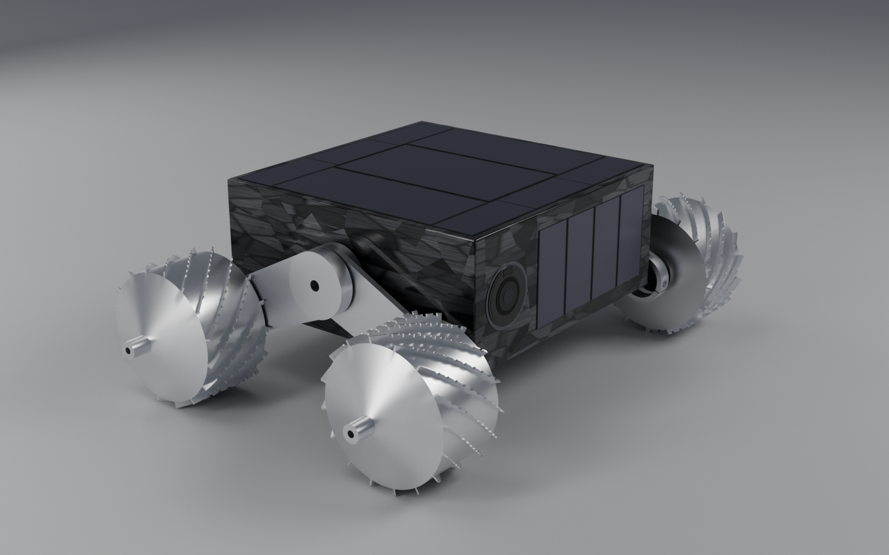

<p align="center">
  
</p>

# jpl-nanorover

Research toward an open replica of the JPL nanorover, the small four-wheeled asteroid rover designed for the Japanese MUSES-C (Hayabusa) sample-return mission and cancelled by NASA in November 2000.

The replica aims to match the original's appearance and dimensions and to perform most, if not all, of its non-science functions: driving on four wheels, posing its four struts independently, self-righting, solar power, and the camera. Spaceflight readiness is not a goal, and neither is the science payload (the IR spectrometer and so on) beyond what is needed to look right.

> **Status: research plus a first-pass 1:1 CAD model.** Sourced dimensions are in the bibliography. The CAD (build123d) has the body, lid and seals, thread
> inserts, hub studs, four struts and four wheels, with checks that the parts fit and clear each other. Scale, materials, manufacturing method and how the
> struts are actuated are undecided; wheel proportions, the strut layout and several other details are labelled assumptions or photo estimates, not published figures.

## Target
The reference units are the two built JPL prototypes in the photographs and videos: a silver-bodied unit (a round imaging window and a sealed-beam headlamp on one end face) and a black-bodied unit (a square camera window), which share their struts and wheels. Measured against a quarter in one photo, the black unit is about
139 x 139 mm on top with wheels about 59 mm across and struts about 76 mm, and the silver unit about 125 x 140 x 55 mm. The MUSES-CN papers give a 14 x 14 x 6 cm body, 6.5 cm wheels and 7 cm struts, and win by default where the units do not agree with each other
independently (`docs/design-comparison.md`); the units differ from the papers by 8 to 11%. Solar cells on four of six faces and about 1.3 kg stay as published reference. Wheel tread, strut cross-section, hub detail and finish are not published and are scaled from photographs.
Every figure is marked with how well it is sourced, and conflicting figures are listed.

## What's here
| Path | Contents |
|---|---|
| [`docs/jpl-nanorover-literature.md`](docs/jpl-nanorover-literature.md) | Annotated bibliography, specification table with verification levels, image sources and the list of conflicting figures |
| [`docs/body-spec.md`](docs/body-spec.md), [`strut-spec.md`](docs/strut-spec.md), [`wheel-spec.md`](docs/wheel-spec.md) | The CAD design decisions: what is sourced, what is measured from the photo, what is assumed, and the checks |
| [`docs/handover.md`](docs/handover.md) | Where the project stands: sources, decisions, open questions, CAD status, corrections made and next steps |
| [`docs/design-comparison.md`](docs/design-comparison.md) | The three designs in the sources (the published design and the two photographed units), side by side, with what the CAD is today and what choosing would change |
| [`docs/toy-version-notes.md`](docs/toy-version-notes.md) | A side discussion: could a stripped nanorover have been a toy around 2000, and should the project pivot (with sources) |
| [`docs/smaller-than-nanorover.md`](docs/smaller-than-nanorover.md) | A side question: what the sources say about rovers smaller than the nanorover (the 10 to 100 g task goal, widget boards) |
| [`docs/era-of-robotics.md`](docs/era-of-robotics.md) | Research on the late 1990s to early 2000s robotics scene (Handy Board, Rug Warrior, Stamp, RCX, BEAM, CMUcam, Brooks): what the "spirit" is, how today differs, candidate design rules |
| [`docs/electronics-concept.md`](docs/electronics-concept.md) | The electronics principle (the spirit of the Handy Board and CMUcam era), what was found for the processor and the camera, and the open decisions |
| [`docs/sim-spec.md`](docs/sim-spec.md), [`sim/`](sim/) | A browser simulation of the operator console (three.js, Vite, TypeScript, modelled on maha-rover's): a fun test of driving the rover through a low-fidelity 3D map with photographs on request; spec, findings and how to run it |
| [`docs/photo-measurements.md`](docs/photo-measurements.md) | Camera solution and measurements (solar cell sizes, wheel) taken from the JPL prototype photograph |
| [`hardware/`](hardware/) | Parametric CAD (build123d, STEP output): [body](hardware/body/body.py), [struts](hardware/strut/strut.py), [wheels](hardware/wheel/wheel.py), [assembly](hardware/assembly/rover.py) |

## Running the CAD
```
python3 -m venv .venv
.venv/bin/pip install -r hardware/requirements.txt
.venv/bin/python hardware/body/body.py        # then strut/strut.py, wheel/wheel.py, assembly/rover.py
```
Each script prints its checks and writes STEP files to an `out/` folder beside it. Run them from the repository root, in that order. `body.py` needs Hammond's
1590Z090 STEP file, which is not in this repository (see [`NOTICE.md`](NOTICE.md)); it is read from the private companion repository `jpl-nanorover-private`
cloned beside this one, or from the path in `HAMMOND_1590Z090_STP`.

## Contributing
Corrections with a primary source are the most valuable contribution, especially dimensions of the hub, wheel and struts, or engineering drawings. Contact with the JPL Robotics group or JPL Archives is the only known route to authoritative dimensions.

The source papers, photographs and video, and Hammond's CAD file, are kept in a separate private repository, `jpl-nanorover-private`, because they belong to their publishers. Contributions to the CAD should come with a source or a measurement for any dimension they change; see [`CLAUDE.md`](CLAUDE.md).

## License model
- **Code** (scripts, tooling) is licensed under **Apache-2.0** (see [`LICENSE`](LICENSE)).
- **Hardware designs** (the CAD scripts and their STEP output), **mechanical documentation and bills of materials** are licensed under **CERN-OHL-S-2.0**, strongly reciprocal (see [`LICENSE-HARDWARE.txt`](LICENSE-HARDWARE.txt)).
- **Documentation** (the notes in `docs/`, READMEs) is licensed under **CC BY 4.0** (see [`LICENSE-DOCUMENTATION.txt`](LICENSE-DOCUMENTATION.txt)).

See [`NOTICE.md`](NOTICE.md) for third-party material. This is an independent hobby project, not affiliated with NASA, JPL or ISAS/JAXA.
