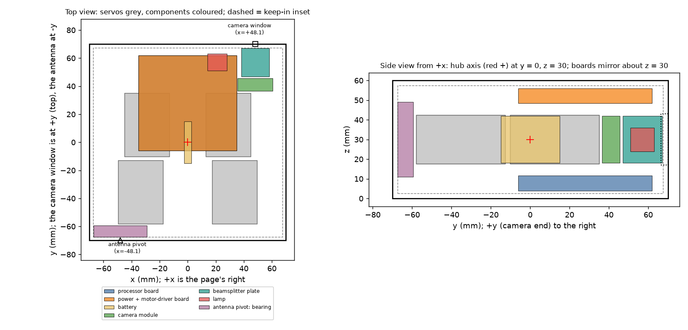

# Body redesign: carbon fibre or forged carbon (started 2026-11-11)

**Owner's decision (2026-11-11):** the body is carbon fibre or forged carbon, 140 x 140 x 60 mm (the papers' figures; the reference unit is still undecided, so no change to size), replacing the 961 g Hammond box (`body-spec.md`, which stays as the record of the earlier body). Not yet chosen: layup versus forged carbon, and how it is made.

## Requirements it must meet (from `handover.md`, section 12)
- About **386 g** for body, electronics, solar cells and camera (1.0 kg design mass less about 614 g of servos, hub, struts, wheels and wheel drive).
- Hub holes opened to **24.2 mm**, on the middle of two opposite 140 x 60 faces, hub axis at 30 mm height.
- Room for four STS3215 servos, 45.23 x 24.73 x 32 mm (positions in `hardware/hub/hub.py`; shaft offset 10.2 mm, measured on Feetech's drawing, see `drivetrain-spec.md`), and the batteryless electronics.
- Centre of mass near the hub axis (the simulation's tip-over numbers assume it).
- **Edges (owner, 2026-11-11): crisp enough to look completely rectilinear, not sharp enough to injure; consumer-product crispness, which I take as an edge radius of about 0.5 to 1 mm.** A single layup over a plug is expected to leave about 1.5 to 3 mm at the corners (general practice, not sourced), so it is borderline at best.
- A sealed or at least dust-tight box, a window (26 mm, silver unit) and room for the headlamp and antenna.

## Mass budget (`hardware/body/cf_budget.py`; typical densities, not measured parts)
The outer surface is 728 cm2. A hollow shell with a lid, in grams:

| Wall | 0.8 mm | 1.0 | 1.2 | 1.5 | 2.0 |
|---|---|---|---|---|---|
| Woven CFRP laminate (1.55 g/cm3) | 90 | 113 | 135 | 169 | 226 |
| Forged carbon (1.45 g/cm3) | 84 | 106 | 127 | 158 | 211 |
| Sandwich, 0.3 mm skins on 0.06 g/cm3 foam | 69 | 69 | 70 | 72 | 74 |

With about 47 g for inserts, hub-bore rings and gasket (my allowance: 4 x 2 g screws and inserts, 4 x 6 g bore rings, 15 g seal), a 1.0 mm woven shell leaves about 226 g for electronics, cells, camera and wiring; 1.5 mm leaves about 170 g; 2.0 mm about 113 g. **So the mass target closes, with a wall of about 1 to 1.5 mm; the Hammond box could not (961 g).** Not yet known: how much the electronics, cells and camera weigh (no parts chosen), and whether 1 mm is stiff enough at the hub holes.

## Things carbon changes (to design for, none yet modelled)
1. **Radio.** Carbon is conductive and blocks RF: the patch antenna on top (papers) needs a non-conductive window or panel, and the headlamp and camera windows need their own cutouts.
2. **Insulating the cells and electronics.** The laminate conducts: solar cells, wiring and the board need an insulating layer or standoffs. Cells bonded to bare carbon would short.
3. **Galvanic corrosion.** Carbon against aluminium in a damp joint corrodes the aluminium; use insulating washers, coatings or stainless/titanium hardware at the hub rings and inserts.
4. **Hub loads.** The strut hub loads go into a thin shell (hold torque up to 0.166 N.m per strut plus wheel loads in a drop): the hub bores need a bonded reinforcing ring or local thickening; the hub housing's flange (28 mm, `hub.py`) spreads the load.
5. **Corners and joints.** A box of continuous fibre needs a mould or plug; flat plate bonded into a box is simpler but its corner joints decide stiffness and sealing. Forged carbon (chopped prepreg, compression-moulded) can form bosses, ribs and a lid lip in one piece, but needs a metal mould (cost), and its strength is lower and less predictable than woven laminate.
6. **Sealing.** The earlier O-ring in a groove in a lid plate (`body-spec.md`) does not carry over; a moulded lip, a gasket on a flat flange, or a bonded joint needs choosing.
7. **Thermal.** The cast box was the servos' and electronics' heat path; carbon (laminate) conducts poorly through the thickness. The servo hold test (`handover.md`, section 12, item 6) matters more.

## Woven laminate versus forged carbon (deeper comparison, 2026-11-11)

Numbers by `hardware/body/cf_compare.py`. **Sourced** = from a cited page; **mine** = my arithmetic; **unverified** = a typical value I did not find a source for.

### What the sources say
- **Forged carbon (Easy Composites, [mechanical properties of forged carbon fibre](https://www.easycomposites.eu/learning/mechanical-properties-of-forged-carbon-fibre); sourced, but the page says "no formal ISO or ASTM standards were applied", gives no specimen size, no scatter and no fibre fraction, and calls the results comparative):** density 1.5 g/cm3; tensile yield 192 MPa and flexural modulus 35.5 GPa for standard forged carbon; an "optimised" version with continuous tow added reaches 875 MPa and 61.1 GPa at 1.58 g/cm3 (continuous tow should not exceed about 50% of the carbon weight, or voids are likely). Recommended wall 1 to 10 mm, features under about 0.5 mm avoided, resin Tg about 92 C for the IN2 system or over 160 C for EL160, "small to medium" parts (about 500 x 500 mm at most).
- **Woven or 0/90 laminate ([DragonPlate FAQ](https://dragonplate.com/just-how-strong-is-carbon-fiber); sourced, generic):** about 600 MPa tensile strength and about 70 GPa tensile modulus for a balanced 0/90 laminate. The script uses a flexural modulus of 50 to 70 GPa (mid 55); that range is a typical figure, **unverified** for any particular layup.
- **A Warsaw University of Technology conference abstract ([PDF](https://read.meil.pw.edu.pl/wp-content/uploads/Program/2026/Abstracts/ID40.pdf); sourced, truncated):** forged carbon is highly isotropic in-plane, with lower absolute tensile strength than unidirectional laminates; fibre length (6 versus 15 mm) matters.
- **Rock West Composites' forged blocks ([datasheet](https://www.rockwestcomposites.com/downloads/RWC_forgedblocks_tds.pdf); sourced):** tensile strength over 113.7 MPa and modulus over 46.88 GPa, but the datasheet says these come from mathematical models and need testing.
- **Tooling and process ([HPA, compression moulding and forged carbon](https://www.hpacademy.com/courses/motorsport-composite-fundamentals/construction-techniques-compression-moulding-and-forged-carbon/); a summary page):** forged carbon is a high-volume process with a costly compression mould (an illustrative $25,000 mould and $100 part in one source, not a quote). Cheaper routes mentioned: hand-placed chopped fibre in a mould, chopped prepreg sheet, and dry chopped tow with liquid epoxy in an FDM-printed compression mould (no costs given). A practitioner forum post says chopped moulding compound suits cosmetic parts and that for a highly loaded structural piece they want a fabric or unidirectional layup.
- **RF ([Mobility Engineering Tech, composite enclosures](https://www.mobilityengineeringtech.com/component/content/article/40988-sae-ma-00113) and others; sourced, general):** carbon-fibre enclosures give modest shielding (about 20 to 40 dB), and a shielded box's leakage is dominated by its apertures and joints, not its walls. That applies to both materials equally: neither lets an antenna radiate from inside.
- **Not found:** through-thickness thermal conductivity of either material, galvanic corrosion data for carbon on aluminium, and a minimum wall for compression-moulded forged carbon beyond Easy Composites' "at least 1 mm". The corrosion and thermal points here are from general knowledge, **unverified**.

### What the project's own numbers say (mine)
| Question | Result |
|---|---|
| Wall for the same panel stiffness as 1.0 mm woven (E 55 GPa) | forged standard 1.16 mm (+12% shell mass); forged optimised 0.97 mm (-2%); woven E 70 gives 0.92 mm |
| Are the hub loads a strength problem? | No. 1.0 kg, half on each hub: 0.2 MPa bearing on a 1 mm wall (4 MPa for a 20 g impact), bond shear 0.16 MPa from 0.33 N.m. About 50 times below even the standard forged figure |
| Is heat a problem? | No. About 0.8 W for four servos holding, about 1.6 K rise over a 0.073 m2 box in still air (servo current assumed proportional to torque; idle 0.1 W each assumed) |
| Plies for a 1.0 mm woven wall | 4 to 5 plies of 200 gsm twill, or 4 of 245 gsm (at 50% fibre volume) |

The hub-load result covers only the hub. **A drop on a corner or edge, and a wheel strike, are not analysed**, and that is where the materials differ most: woven fabric is stiffer and stronger per mass, while forged is isotropic and damage-tolerant in all directions (a vendor claim, [Nitpro](https://www.nitprocomposites.com/blog/carbon-fiber-reinforced-polymer-vs-forged-carbon-whats-the-difference); unverified).

### How each is made at this size (a 140 x 140 x 55 mm tub, about 1 mm wall)
| | Woven laminate | Forged carbon |
|---|---|---|
| Hobby route | Wet layup or vacuum bag over a male plug (printed or machined), or CNC-cut flat plate bonded into a box with corner fillets | Dry chopped tow plus liquid epoxy pressed in a printed two-part mould, or chopped prepreg in a metal mould and heated press |
| Tooling | One plug (printed or foam); no press | A two-part matched mould that withstands pressing; a metal one is the costly case. Needs draft (about 3 degrees assumed) |
| A 55 mm deep tub with 1 mm walls | Easy: plies drape over the plug; corners need small radii | The hard case: chopped material must flow 55 mm up thin walls, so voids, thin spots and resin-rich corners are likely (**my judgement, not sourced**) |
| Bosses, ribs, lid lip | Bonded on (printed or machined inserts) or built up | Can be moulded in one piece: the real advantage |
| Holes (hub bore 24.2 mm, window) | Drilled or routed after cure, with backing against delamination; the dust is conductive and an irritant | Same; no ply delamination in an isotropic part |
| Finish | The weave shows through a clear coat (or it is painted) | Marbled; fine detail is softened, per Easy Composites |
| Repeatability | Good with a controlled layup | Depends on how evenly the chips are placed |

### Reading
- **Neither is chosen by strength or heat.** Both are far over the loads that were computed.
- **Woven laminate** suits a thin, deep, 1 mm tub better: equal or lighter at equal stiffness, a cheap one-off route (one plug), and predictable. It cannot form bosses, so bosses are bonded on.
- **Forged carbon** earns its place only if the body needs integral bosses, ribs and a lid lip in one piece **and** a proper mould is affordable. Its cheap hobby route is weakest at exactly the 55 mm-deep thin-walled shape the tub needs. The marbled look is its main non-structural draw, and a painted or wrapped body, as the black and silver units are, cancels that.
- **A hybrid** is possible: a woven tub with moulded forged or printed bosses and hub rings bonded in. It adds a joint but puts each material where it is good.
- **Appearance against the originals:** the black unit's body is black and the silver unit's silver (`design-comparison.md`); a bare carbon body matches neither, whichever type. If looking like the originals matters, either type needs finishing, and then the look argument for forged disappears.

~~**Recommendation: woven twill laminate, 4 to 5 plies (about 1.0 mm), made over a printed plug as a tub with a separate lid, with bonded printed or machined hub rings and bosses.** I would revisit forged carbon only for the lid or the bosses, if a mould becomes available. This follows from the 55 mm draw and the one-off nature of the build, not from strength.~~ **Superseded by the edge requirement:** **Revised recommendation (after the edge requirement above): woven carbon as six CNC-cut flat plates of about 1.0 mm, bonded into a box, with every outside edge broken to a 0.5 to 1 mm radius by hand and the cut edges sealed with epoxy; the lid is one plate that stays removable.** Flat plates give true flat faces meeting at a crisp edge with no tooling, and a flat face is the best surface for the solar cells. The cost is that the box is no longer seamless: each edge needs an inside key (a printed or carbon angle) to carry load and seal the joint, which I estimate at about 25 to 30 g with adhesive (my rough figure, not designed), and the cut fibre ends need sealing. A layup over a plug stays the fallback if you accept 1.5 to 3 mm corners; forged carbon is only worth it if a proper mould is available. Both choices follow from the edge and the build, not from strength. The inputs are mine or vendor-supplied and untested; a printed-plug test tub and a drop test would settle it.

## Cost: bonded woven plates versus forged carbon in 3D-printed moulds (2026-11-11)

Model: `hardware/body/cf_cost.py`; every input there is tagged **SRC** (a vendor page) or **ASM** (my assumption). Results in US dollars, low / mid / high; **shipping, import duty, dangerous-goods surcharges on resin, tax and your time are not included**, and the exchange rates (1 GBP = 1.30 USD, 1 ZAR = 0.055 USD) are assumptions. Treat the totals as order-of-magnitude.

### Sourced inputs
- **Woven sheet (Easy Composites, [1 mm high-strength twill sheet](https://www.easycomposites.co.uk/high-strength-carbon-fibre-sheet)):** GBP 257.78 per m2 ex VAT (so about GBP 61 for a 500 x 470 mm sheet; **the GBP 14.50 headline price is the smallest, 250 x 230 mm, sheet**, a correction to a first reading), sheets 250 x 230 to 2000 x 980 mm, 1, 2, 3 and 4 mm only (no 1.5 mm). Easy Composites **does not cut** sheet: it says to use a waterjet or CNC machinist. Rock West lists a 600 x 600 x 1 mm twill plate at USD 188.99 (a search snippet; the page I fetched showed no price, only options, so unconfirmed). Rock West also offers a custom-cut plate with a "forged/marbled" pattern option, on request for a quote; I did not get a price or confirm it is true chopped carbon.
- **Cutting:** Flying Robot ([CNC carbon cutting](https://flyingrobot.co/products/cnc-carbon-cutting-per-sq-cm), South Africa): ZAR 1.72 per cm2 for 1 mm, minimum 100 cm2, quote from a DXF. The only per-area price I found; other services quote per job. FMS Carbon says tolerance is about +-0.1 to 0.2 mm on thickness.
- **Forged materials (Easy Composites, [forged carbon kit](https://www.easycomposites.co.uk/forged-carbon-fibre-kit) and [compression moulding guide](https://www.easycomposites.co.uk/learning/compression-moulding-forged-carbon-fibre)):** kit GBP 66.63 ex VAT (750 g CT-12 chopped tow, 50 g long tow, 1 kg IN2 epoxy with fast hardener, release wax, gloves, pots; classed as dangerous goods for shipping); chopped tow GBP 8.65 per 150 g, IN2 fast GBP 22 per kg, release wax GBP 13.90, TC80 tool-cast epoxy GBP 67.50 for 5.3 kg. Recipe: fibre is 60% of the finished part mass, mix about 25% more resin than fibre weight, excess squeezed out. Rock West ([forged starter kit](https://sfccdev.rockwestcomposites.com/chopped-kit.html), a snippet from what looks like a staging site): USD 269.99 for 1.5 lb of 12 mm chopped carbon and West System slow epoxy.
- **Printed moulds (same guide, and [Dynamism](https://www.dynamism.com/learn/automotive/how-to-3d-print-carbon-fiber-molds.html)):** PETG at 75% infill or more and 0.15 mm layers or finer; FDM layer lines transfer to the part, so a good surface needs the mould sealed and coated; cure is at ambient temperature (a heated cure warps PETG moulds); **a printed mould suits "short runs and one-off prototypes", no count given**; cast epoxy tools are good for "tens if not hundreds" of parts. The mould needs "compression space" (a telescoping section at least 25% of the part depth) and 2 to 3 degrees of draft on the telescoping section. **No clamping force is given**; small moulds go in a vice or G-clamps, larger ones in a press. **Wall thickness: 1.5 mm is "very much towards the lower limit"** that can realistically be moulded.

### Result (mine; `cf_cost.py`)
| Bodies built | Bonded woven plates (low / mid / high) | Forged, printed moulds (low / mid / high) |
|---|---|---|
| 1 | $173 / $299 / $531 | $137 / $523 / $1,173 |
| 2 | $254 / $428 / $743 | $156 / $603 / $1,396 |
| 5 | $656 / $1,036 / $1,757 | $212 / $945 / $1,748 |
| 20 | $2,427 / $3,744 / $6,260 | $631 / $2,455 / $3,984 |

- **For one body the two overlap**, so cost does not decide it. At the mid assumptions woven is cheaper for 1 to 2 bodies, the two cross at about 4 or 5, and forged is cheaper beyond that, because the printed mould is paid for once and the plates' cutting cost recurs.
- **What drives each result:** for plates, the cutting price (the one sourced figure, South African, is the low case; mid and high are my guesses) and the sheet price. For forged, **how many parts a printed mould lasts (assumed 10 / 5 / 2), how many parts are lost learning a 55 mm deep 1.5 mm tub (1 / 3 / 5), and the press (a vice you own, or a shop press at about $250)**. None of these is sourced.
- **Material for the forged part is cheap:** about $18 to $46 per part at the listed prices. The cost is the tooling and the learning.
- **Printing:** the cavity block and plug are about 2 kg of PETG and, by my estimate, about 140 hours of printing on a hobby FDM machine. If you do not own a printer with a bed of at least about 170 mm, that is a cost not in the table.

### What the cost model does not capture (the real differences)
1. **Mass.** At 1.5 mm, the thinnest the source calls realistic, a forged shell is about **164 g** (at 2.0 mm about 218 g). The woven plate box is 113 g of plate plus about 25 to 30 g of keys and adhesive, about 140 g. With about 47 g of other allowances and 386 g to spend, forged leaves about 175 g for electronics, cells and camera, against about 200 g for plates. Not decisive, but it narrows the budget.
2. **Edges and draft.** A moulded forged tub can take its crisp edge from the printed mould's corner (about 0.5 to 1 mm is printable; the chopped material should flow into it, **my judgement, not sourced**), with no edge joint. But a pulled tub 55 mm deep needs draft: at 1 degree the sides lean about 1 mm each over the depth, at 2 degrees about 1.9 mm, which works against "completely rectilinear". The 2 to 3 degrees in the guide is for the telescoping section, not necessarily the outer faces, so the outer-face draft is unresolved. Plates have none.
3. **Surface.** FDM layer lines transfer to the part, so a consumer-grade finish needs a coated, sanded mould (in the cost) and probably clearcoat on the part.
4. **Risk and time.** A 55 mm deep 1.5 mm tub is at the edge of what the guide calls realistic; plates are a well-trodden route. By my estimate plates take about 8 hours of work against about 140 hours of printing plus finishing and trial pressings for forged, with an uncertain cure time (not stated by the source).
5. **Integral features.** A forged tub can mould in the bosses, hub rings and the lid lip, which the plate box buys as separate bonded parts.

### Reading
- **Forged with printed moulds is not meaningfully cheaper for one body.** Its low case is cheaper and its mid and high cases are well above plates; only a run of about five or more bodies shows a clear advantage.
- **What forged buys is integration** (no edge joints or keys, moulded bosses) **at the price of risk, time, a heavier shell and an unresolved draft problem.** What plates buy is a predictable, tooling-free route, flat faces for the cells, and no draft.
- **Revised recommendation stands (bonded woven plates)** for a first body. **A middle path worth testing cheaply:** print a small test mould for the lid or a corner and press one forged part, to see what edge radius, surface and thickness the process really gives before committing to the deep tub.
- **Uncertainty:** the table's gap between low and high is a factor of 3 to 8; the sourced prices pin only the materials. Get two quotes (a cutting service for the six plates, and a print or press) before treating any figure as a budget.

## Decision deferred; interior layout first (owner, 2026-11-11)

**The woven-versus-forged choice is deferred** until the interior is laid out, so the comparison can use real part placement instead of allowances. The layout is material-independent by design:
- **Keep-in volume:** the 140 x 140 x 60 mm envelope pulled in **2.5 mm** from every outer face (a 1.5 mm forged wall plus 1 mm of draft and tolerance; a 1.0 mm plate wall fits inside with room to spare), minus a **6 mm strip along every edge** (room for the plate box's bonded keys). If forged wins the keys disappear and the interior only gains room; designing for forged and then switching to plates would be the risky direction.
- **Fixed regardless:** the 24.2 mm hub bores, the servo and hub positions from `hub.py`, the window (26 mm, on the +y face at x = +40.8, z = 36.8), the headlamp about 30.6 mm toward -x of it.
- **What the layout feeds back to the comparison:** the real wall-thickness need (local thickening at the servos, board mounts, camera), the number and place of mounting bosses (many favour forged, which can mould them in; few favour bonded standoffs), whether the interior tolerates draft, the lid face and size, a measured mass, and a better cost model.
- **In parallel, if wanted:** a small printed test mould for a lid or corner (about $100) to see the real edge radius and surface forged gives.

## Interior layout, first pass (`hardware/body/layout.py`, 2026-11-11)

Top view looking down with +y (the window end) at the top and **+x on the page's right, so the window at x = +40.8 appears on the right here; standing at +y facing the end face (the viewer's view) it is on the left.** The side view looks from +x with +y to the right. Servos grey, components coloured, the dashed line is the keep-in inset; overlaps between a component and a servo in one view are projection (they differ in the other axis).

**All component sizes and masses are placeholders (ASM): no electronics, camera, headlamp, antenna or cells have been chosen.** The servos and hub are the real modelled geometry from `hub.py`, with 1 mm clearance.

### What the numbers say
| | Result |
|---|---|
| Keep-in volume | 1,016 cm3 (of 1,176 cm3 envelope) after the 2.5 mm inset and 6 mm edge strips |
| Taken by servos and hub (1 mm clearance) | 198 cm3; **818 cm3 free** |
| Free bays | front (behind the window, y beyond servo B): 136 x 32 x 56 mm, 236 cm3; lower (under the servos): 136 x 136 x 15 mm, 268 cm3; upper (above them): 136 x 136 x 15 mm, 268 cm3; rear: 136 x 9 x 56 mm, only 62 cm3; centre gap between the two servo pairs: 16 mm wide x 136 x 56 mm, 121 cm3 |
| Placed placeholders | main board 70 x 68 x 7.6 mm (lower bay), power board 44 x 30 x 6 mm and a 35 x 35 x 4 mm patch antenna (upper bay), a 25 x 24 x 9 mm camera behind the window, a 22 x 14.5 x 15 mm headlamp: all clear of the keep-in limits, the servos and each other; **they use 7% of the free volume** |

- **Volume is not the constraint; mass is.** With over 800 cm3 free and the placeholders using 61 cm3, the box has far more room than it needs. The 386 g budget is the tight resource.
- **Solar cells are the biggest unknown in the mass budget.** Cells on four faces at 60% coverage are about 560 cm2 x 0.6; at an assumed 0.15 to 0.35 g/cm2 (**no cell chosen**) that is 50 to 118 g. Total body contents (shell, rings and screws 32 g, seal 15 g, electronics and wiring 85 g, cells):

| Shell | cells 0.15 g/cm2 | 0.25 | 0.35 |
|---|---|---|---|
| woven plates 1.0 mm + keys (141 g) | 323 g (63 g under 386) | 357 g (29 g under) | 391 g (5 g over) |
| forged tub 1.5 mm (164 g) | 346 g (40 g under) | 380 g (6 g under) | 414 g (28 g over) |

  So **the shell choice is worth about 23 g, the cell choice 68 g.** Forged at 1.5 mm is only workable with light cells, and plates with all but the heaviest. Light cells matter more than the shell material.
- **Balance.** The simulation put the whole rover's centre of mass 2.9 mm toward -y of the hub axis because the two servos on a side sit at different y (servo B +12.4, servo A -35.4 mm). With the camera, headlamp and main board toward the +y end, the body contents' centre of mass is at **y = +5.7 mm** (z = 29.1 mm against the hub at 30), which moves the whole rover's to **y = -0.9 mm** (z shift 0.3 mm). A 386 g body would need +7.5 mm to centre it exactly. This is a good side effect of putting the camera at the window end; the sim's tip-over numbers improve slightly (not re-run).

### Cautions
- The 1 mm voxel grid and 1 mm clearance make the checks good to about 1 mm. The servo connector side, cable bends, the hub housing's retention and the strut stops are not modelled.
- The antenna in the top face needs a non-conductive window; with a carbon body it cannot sit behind a bare top.
- The camera and headlamp positions put their mass at the front, which also moves the centre of mass; changing them changes the balance.
- Nothing has been placed for the lid screws, board standoffs, camera mounts, sealing or the wiring paths.

### Next
1. Choose cells (the 68 g spread), and a board/camera/lamp, so the placeholders become parts.
2. Decide the lid face, which fixes the joints and the seal for either shell material.
3. Re-run the comparison (`cf_cost.py`, `cf_compare.py`) with the real wall thickness, mount count and mass.

## Owner's layout decisions and power study (2026-11-11)

**Decisions (owner), recorded in `CLAUDE.md`:**
1. **Top and bottom faces are the lids**, identical, each carrying solar cells so the rover works as well upside down; cells also on the front and back (end) faces, as the papers planned (cells on four of six faces); none on the hub faces, where the struts are.
2. **The body is kept symmetric about the transverse (z = 30) plane**: for a centred centre of mass and so the same parts can be reused around the body.
3. **Camera window centred on a 60 x 60 mm square at one end of an end face**, i.e. 30 mm from the top, bottom and side edges: x = +40, z = 30 on the +y face. (The earlier window, copied from the silver unit, was at x = +40.8, z = 36.8.)
4. **One window shared by camera and lamp**, through a beamsplitter.
5. **Antenna on the opposite end face, at the diagonally opposite position** (x = -40, z = 30 on the -y face: a 180 degree turn about z carries the camera's square onto the antenna's), a whip standing vertically in the plane of the face, on a low-friction pivot with a counterweight so it points up whichever way up the rover is.

**These are deliberate departures from all three descriptions of the original** (papers, silver unit, black unit): none has cells on a bottom lid, a shared camera and lamp window, or a gravity-oriented antenna. The papers' own antenna is a patch on the top face.

### Solar cells: target layout and area
- **Top and bottom faces (each):** the black unit's measured top-face layout (`photo-measurements.md`): 10 large cells of about 39.6 x 23.5 mm in two columns of five, and 4 centre cells of about 19.6 x 44 mm (plus or minus 2 mm), with gaps of 5 to 8 mm: **127.6 cm2 per face (65% of the 196 cm2 face)**. The NASA Space Place toy decal has 5 + 5 edge rows, 4 centre cells and 2 + 2 more on the other edges, 18 flat cells; it is a simplified drawing, so I used the measured layout. The black unit's raised centre block is left out: the antenna no longer goes there.
- **End faces (each):** the 60 x 60 mm window or antenna square leaves an 80 x 60 mm area; **three cells of 23.5 x 39.6 mm standing side by side fit** (about 76.5 mm with 3 mm gaps), **27.9 cm2 each**. No source gives an end-face layout; this is my choice. The two end faces are 180 degrees symmetric.
- **Total 311 cm2** (top 127.6 + bottom 127.6 + two ends 55.8). Mass at an assumed 0.15 to 0.35 g/cm2 (no cell chosen) is **47 to 109 g**; the bottom face alone is 19 to 45 g.

### Power: what the cells can supply (`hardware/body/power_budget.py`)
Sourced: 1000 W/m2 AM1.5 full sun; measured output at 500 lux LED of about 8 uW/cm2 (polycrystalline silicon) and 10 uW/cm2 (amorphous silicon) (from a web-search summary of indoor-photovoltaic studies; **I did not open the paper that reports them, so the figures are unconfirmed**; related background: [MDPI, typical artificial light sources for indoor PV](https://www.mdpi.com/1996-1073/7/3/1500)); STS3215 about 180 mA moving at 12 V and a standby draw between 6 mA (datasheet) and 60 mA (some listings), sources disagree; a bare ESP32-S3 deep sleep of 7 to 8 uA ([Lucidar](https://lucidar.me/en/esp32/power-consumption-of-esp32-s3-devkitm-1/)) and about 31.7 mA connected on a dev board. Assumed (**ASM**): cell efficiency 15 / 20 / 24%, a 10% overcast, radio transmit 0.65 W, camera 0.3 W, lamp 0.2 W, wheel motors about 0.1 W each.

| One lit face supplies | Power |
|---|---|
| Full sun, square to it (20% cells) | **2.55 W** (1.9 to 3.1 W over the efficiency range) |
| Full sun, 45 degrees off | 1.8 W |
| Thin overcast (ASM) | 0.26 W |
| **Indoors, 500 lux LED** | **about 1 to 1.3 mW** |

| Scenario | Load |
|---|---|
| A keep-alive: MCU deep sleep, RTC, wake input | about 0.1 mW (ASM) |
| B controller awake, radio idle | 0.105 W |
| C camera, radio streaming and lamp | 1.26 W |
| D driving (wheels, controller, radio, camera; four servos holding at 30 mA each) | 2.9 W (servo hold alone is 1.4 W; 0.3 to 2.9 W over the standby range) |
| E posing one strut (one servo moving) | 4.5 W |

Surplus of one lit face (W): in full sun A +2.55, B +2.45, **C +1.30, D -0.34, E -1.94**; overcast A +0.26, B +0.15, C and beyond negative; **indoors only A is positive (+1 mW) and even B is short by 0.1 W**. A 500 mAh battery (1.85 Wh, about 12 g, ASM) runs scenario D for about 38 minutes, C for 88 minutes and B for 18 hours; indoors the panel adds 0.031 Wh a day, 1.7% of it.

**What this means for your two ideas:**
- **Panels charging the rover:** works **outdoors**: in sun an idle rover (B) nets +2.4 W and the battery refills in about 45 minutes; even thin overcast beats idle (+0.15 W). **Indoors it does not**: 1.3 mW is about 1% of idle-with-radio. So the panels are an outdoor charger and an indoor trickle at best.
- **A subsystem run directly from the panels, so battery loads can power down fully:** in sun the whole controller, radio, camera and lamp (C, 1.26 W) runs from one face with 1.3 W to spare, so that works outdoors. **Driving (D) and posing (E) exceed one face even in full sun**, so they need the battery (the cells extend its runtime). **Indoors the only thing the cells can run is a micro-power keep-alive** (scenario A, a timer or wake input, tens of microwatts), which is enough to let the battery loads hard-off with a load switch and be woken from outside.
- **Suggested architecture (mine, for your decision):** three tiers: a keep-alive controller on the cells with a small supercapacitor; the battery behind a load switch for everything else (hard off at idle); the cells topping up the battery outdoors. **Servo hold current is the biggest unknown and the biggest lever**: four servos holding is 0.3 to 2.9 W against the sources' 6 to 60 mA range, so test whether the STS3215 holds a pose unpowered (already in the handover's prototype tests); if it does, idle drops to the keep-alive.
- **The bottom cells** exist for inverted operation. Right way up they see almost no light (the floor is 32 mm below, in the rover's own shadow), so they cost 19 to 45 g for a use that is occasional. That is your choice; the numbers just show the price.
- Not decided: the cell type (a-Si does better indoors, crystalline outdoors; the indoor figures are roughly 8 to 10 uW/cm2 for either), the battery chemistry and voltage (the servos and wheel motors want 12 V and 6 V, so boost converters or a 2S pack, neither modelled), and the radio.

### Layout with these decisions (`hardware/body/layout.py`; first pass, placeholders)
- **Two identical lid modules:** a processor board (about 20 g) on the bottom lid and a power and motor-driver board (about 20 g) on the top lid, mirror images about z = 30; the **mass above z = 30 equals the mass below (52 g each, cells and boards)**. The camera, beamsplitter, lamp, battery and antenna pivot sit on the plane. **Centre of mass x = +0.3 mm, z = 30.0 mm** (servos and hub included). The lid modules need a board-to-board link between them when a lid is removed: not designed.
- **Camera and lamp:** window axis at x = +40, z = 30. The camera (25 x 24 x 9 mm) sits behind at y = 36.5 to 45.5, looking +y through a 28 x 24 x 1.5 mm glass **plate** beamsplitter at 45 degrees (bounding box 20 x 20 x 24 mm at y = 47 to 67), and the lamp is on the body-centre side of the plate (x = 14 to 28) shining +x so the plate reflects it out of the window. All inside the free front bay, clear of servo B by 1 mm. **A 25 mm cube beamsplitter would weigh about 39 g (my estimate) against about 3 g for a plate.**
- **Antenna pivot:** a bearing, rotary RF joint and a 40 mm swing disc carrying the counterweight, behind the -y wall at x = -40, z = 30, 8 mm deep (y = -67.5 to -59.5), 2 mm clear of servo A; the whip stands outside.
- **All placeholders clear** the keep-in volume, the servos and each other; they use 14% of the free volume (113 of 818 cm3). Volume is still not the constraint.
- **Mass** (shell, rings and screws 32 g, seal 15 g, electronics 100 g now including battery, beamsplitter, pivot and wiring, and cells):

| Shell | cells 0.15 g/cm2 (47 g) | 0.25 (78 g) | 0.35 (109 g) |
|---|---|---|---|
| woven plates 1.0 mm + keys (141 g) | 335 g (51 g under 386) | 366 g (20 under) | 397 g (11 over) |
| forged 1.5 mm (164 g) | 358 g (28 under) | 389 g (**3 over**) | 420 g (34 over) |

  The shell choice is worth 23 g and the cell choice 62 g. **Forged at 1.5 mm is over budget at the middle cell weight; plates are not.** This leans further toward plates, and a four-wall frame with two identical lids suits plates directly (four 140 x 60 wall plates and two 140 x 140 lid plates), where forged would need a deep through-frame mould.
- **Balance:** the whole-rover centre of mass is about **-1.7 mm in y** (the simulation had -2.9). It is less well centred than the first pass (-0.9) because the boards are now centred; shifting the boards about 10 mm toward +y would centre it. The antenna's mass (13 g at -y) is partly offset by the camera group (20 g at +y).

### Problems to resolve (found while placing these; none is a blocker)
**The gravity-oriented antenna (a pendulum):**
1. **The counterweight must over-balance, not balance.** A pivot balanced exactly stays wherever it is left. For the whip to hang up, the weight opposite the whip must have a larger moment than the whip: the net unbalance sets the restoring torque. Example (mine): 2 g net at 15 mm gives about 0.3 mN.m; pivot and rotary-joint friction of 0.05 to 0.3 mN.m (an assumed range) would leave a dead band of about 10 to 90 degrees. A net unbalance of 5 g at 15 mm (about 0.7 mN.m) is a better start, within the 10 g allowance for the whole pivot.
2. **It only corrects rotation about its own axis**, which is the y-axis (normal to the end face): the rover rolling side to side. If the body pitches about x (a slope, a stance, a self-righting roll), the axis tilts and the whip tilts with it by the same angle; standing on an end, it points sideways. Fine for the rest poses the rover normally takes, not for steep ones.
3. **The feed needs a rotary RF joint or a limited-turn cable.** Upright to inverted is 180 degrees of rotation, and several rolls in one direction would wind a plain coax pigtail. A sprung contact or capacitive joint works at low frequency but is lossy and noisy; a stop with a pigtail good for about plus or minus 200 degrees is simpler. The antenna may also be a dummy, as the signal is not part of the scope.
4. **Damping.** A low-friction pendulum rings when the rover accelerates or rolls; a little viscous damping (grease, an eddy-current magnet) keeps the whip from swinging.
5. **The whip and the ground.** It stands off the end face by the stub length; rolling end over end in a righting sequence puts the face on the ground, so the whip must be flexible or short.
6. **The wall.** A shaft hole through the -y wall needs a bonded bushing and a seal; a carbon wall also screens the antenna's feed point.

**The beamsplitter:**
1. **Light loss.** A 50/50 plate sends half the lamp light out and passes half the scene light to the camera: ambient light to the camera is one stop darker, and the lamp needs about twice the power for the same illumination on the scene.
2. **Glare.** The lamp light that reflects from the window pane (about 4% per glass surface, then half through the plate) goes straight back into the camera, coaxially, and can swamp the dim return from a diffuse object centimetres away. Remedies: crossed linear polarisers (lamp polarised, camera analyser at 90 degrees), anti-reflection coated glass, a black baffle between the plate and the window, and a wedged plate to avoid a double image. **This is the biggest optical risk and I have not tested it.** A bench test with a cheap plate beamsplitter and a phone camera would decide it before the design is committed.

**Two lids:**
- Each lid has cells outside and a board inside; **when a lid is removed its board comes with it**, so the link between the two boards (and the cells' wiring) needs a connector at the lid joint on a face both lids share.
- Both lids need their own gasket and fasteners, doubling the lid screws and inserts in the budget (not yet doubled).
- Bonded cells on a carbon lid need an insulating layer under them.

## Design method: a solid block with cavities (owner, 2026-11-11; `hardware/body/block.py`)

**Method (owner):** treat the body as a completely solid, uniform 140 x 140 x 60 mm block; cut the components and their required connections and views out of it; when every component is specified and placed, derive from that one block both (a) a chassis made of carbon tubs joined together (the block's faces, exterior and interior, become laminate) and (b) a forged-carbon unibody (the cavities become the cores of a mould). **Purchasing is deferred indefinitely (owner), so no bench tests for now.** Current inputs are the placeholders of `layout.py`.

**What `block.py` does:** cuts 33 cavities from a 140 x 140 x 60 mm block as real CAD: four servo pockets (envelope plus 1 mm, with the output and back bosses), the hub drive on both sides (housing tube through the hub wall, gear and pinion discs, hollow shaft, horn adapter), the two lid-borne boards, the battery, the camera, the beamsplitter plate's bounding box, the lamp and its beam to the plate, the 26 mm window through the +y wall, **the camera's view as a 60 degree cone from the lens to the window**, the antenna swing disc and its shaft hole through the -y wall. It exports `hardware/body/out/body_block.step` (our own geometry), re-imports it (one solid, 867.2 cm3, matching) and measures what the cavities leave.

### What the block says
- **Cavities remove 26% of the block**: 867 of 1,176 cm3 remain. As solid carbon that would be **about 1.34 kg**, so the block is a design volume, never the part: all of the remaining material between the surfaces has to be taken out.
- **Almost everything is far from the outside.** The servo pockets are 11 to 24.5 mm from the nearest outer face and the battery 18 mm; **only the hub tubes (through the hub walls), the window and its optics, and the antenna shaft touch or come within 2 mm of the exterior.** So the exterior skin and the cavities do not share material except at those penetrations: lining a cavity means a second, separate skin.
- **The cost of lining every surface, outside and in** (surface area times thickness; no skin shared with a neighbour):

| Lined surface | Area | 1.0 mm woven | 1.5 mm forged |
|---|---|---|---|
| Outside | 728 cm2 | 113 g | 158 g |
| 4 servo pockets | 331 cm2 | 51 g | 72 g |
| Hub drive, both sides | 154 cm2 | 24 g | 33 g |
| Boards (ride on the lids) | 232 cm2 | 36 g | 51 g |
| Camera, beamsplitter, lamp and window | 94 cm2 | 15 g | 20 g |
| Antenna pivot | 36 cm2 | 6 g | 8 g |
| Battery | 20 cm2 | 3 g | 4 g |
| **Everything** | **1,594 cm2** | **247 g** | **347 g** |

  A voxel check (1 mm, unions where surfaces share material) gives a 1 mm skin of 135 cm3, 210 g woven or 196 g forged, consistent with the area sum less overlaps. **The voxel step is too coarse for 1.5 mm** (it jumps from 141 to 263 cm3 between 1.5 and 2.0 mm, grid rounding); the area-based figures are the better ones.
- **Against the 386 g budget** (shell, rings and screws 32 g, seal 15 g, electronics 100 g, cells 47 to 109 g, all from `layout.py`):

| Treatment | Total at cells 47 / 78 / 109 g |
|---|---|
| Line every cavity (woven 1.0 mm): 247 g of shell | **441 / 472 / 503 g, over budget by 55 to 117 g** |
| Outside + servo pockets + camera group + antenna pivot lined (woven 1.0 mm): 184 g | 378 / 409 / 440 g (under by 8 g only with the lightest cells) |
| Outside only (woven 1.0 mm + 28 g of keys): 141 g | 335 / 366 / 397 g (under by 51, 20 g; over by 11 g with the heaviest cells) |

  **The same holds for a forged unibody.** Forged at 1.5 mm with every surface lined is about 347 g of shell, 530 g or more in total: well over budget.

### Reading
- **The method works as a design tool**: it keeps one master model, shows exactly what touches the outside and what does not, and lets both bodies be checked against the same cavities.
- **The rule for deriving the part is what decides the mass.** **Lining every cavity does not fit the budget at 1.0 mm woven, and certainly not at 1.5 mm forged.** What the block says is that the interior should be mostly one open volume, with a lining or a local feature only for what needs a located, stiff interface: the servo group, the camera and window group, and the antenna pivot. Boards and battery do not need their own tubs: they ride on the lids or on standoffs.
- **The hub drive group does not need a lining either**: the aluminium hub housing is itself the structure; the wall needs a bonded reinforcing ring where the housing tube passes through it.
- **A cheaper way to locate the servos than four tubs:** the four servos could sit between two or three bulkhead plates (so the cost is a plate, not a box around each servo); the block can be re-cut with the bulkheads as surfaces to test this.
- **For the tub chassis:** the four walls and two lids form one set; the servo group, the camera group and the antenna pivot become small tubs bonded into the frame. **For the forged unibody:** the cores are the interior void plus the pockets; the mould is a pair of cores in a cavity, with the same wall rule.

### Design process and material lean (owner, 2026-11-12)

**Process (owner), in order:** (1) component placement; (2) component attachment points; (3) inter-component cavities (wiring, optical paths and so on); (4) access points to the components (for example, removing the material between components and the lids); (5) **topology optimisation for loads, as the penultimate step**; (6) a final refinement so the design can be fabricated. `block.py` covers steps 1 and part of 3 so far (placeholders). Steps 2, 4, 5 and 6 are not started.

**Material lean (owner): forged carbon**, for an aesthetic reason: the random chopped-fibre surface texture resembles the Widmanstatten pattern of iron meteorites, a space connection. This is a lean, not the end of the decision: the woven-plates recommendation above (crisp edges, wall thickness) is still on the table, and the choice stays open until the interior has real parts.

**Precedents found (2026-11-12, web search, not verified in depth):** topology-optimisation tools start from a solid design space and subtract void and fixed (non-design) regions, with loads applied to the non-design regions (Altair Inspire, Hexagon); skeleton-model top-down CAD; CubeSat structures machined from billet, which the industry has partly moved away from (thin sheet-metal chassis, Pumpkin); the Mars Exploration Rover warm electronics box (carbon skins on aluminium honeycomb, electronics isolated on tubes); soluble and fusible cores for hollow composite parts. No source found that derives both a bonded-tub chassis and a forged unibody from one block.

**Notes (mine, not decisions):**
- Forged carbon is closer to isotropic than woven laminate, which suits the isotropic material model of standard density-based topology optimisation; the vendor strength figures are untested (see above).
- The loads are small (0.2 to 4 MPa at the hubs on a 1 mm wall), so the optimiser will mostly return "remove everything"; the result will be set by constraints (minimum wall of about 1.5 mm for forged, mass budget, hub stiffness, lid clamping, drop and righting-roll impacts), so the load cases and constraints need writing down first.
- **Mouldability belongs inside step 5, not only step 6:** enclosed cavities cannot be cored out of a pressed forged part without soluble or fusible cores, so a draw direction (and draft) constraint in the optimisation is the usual remedy. The z = 30 symmetry suggests two identical half-shells bonded at the midplane (one mould), which would split the hub bores; to be tested, not chosen.
- **Texture is visible only where cells are not:** the cells cover 311 cm2 of about 728 cm2 of outer face (about 43%), so the texture shows on the hub faces, the gaps and the edges. A clear coat and the chip size (finer or coarser flakes) decide how much it reads as Widmanstatten; its real pattern is families of straight bands at fixed angles, so the likeness is loose (a metallic, crystalline glint) rather than exact.

### Fabrication route: mould, then machine the outside only (owner, 2026-11-12)

**Owner's idea:** press the forged-carbon body in mould(s) as a near-net form, then **machine only the outside**, which has to reach a specific form and finish; **the inside stays as moulded, so long as everything fits.** The outside stays rectilinear (owner). The outer envelope, cell faces, lid seating faces, hub bores and window are fixed (non-design) surfaces for the optimisation; only the skin thickness and the structure behind them are free.

**Why it helps (mine; from general knowledge, not searched):** the cutter, not the press, makes the crisp outer edges and flat cell and lid faces (the crisp-edge objection to forged carbon shrinks, though the thin-wall problem remains); located features (hub bores, bearing seats, lid seats, window) are cut from the outside and can be finish-machined to position; machining stock is left only on the outside; and nothing inside needs tool access, so the cores only have to give a shape that fits. Forged carbon is sold as machinable stock (Rock West forged blocks, cited above).

**What it adds to the process (mine, to be worked out):**
- A **machining allowance** on the outside (a few tenths of a millimetre is my guess, unchecked), carried in the CAD as moulded-oversize versus final surfaces, marked face by face.
- **Wall thickness after machining** = moulded wall minus allowance, plus or minus the core's shift relative to the mould. The minimum wall of about 1.5 mm for forged carbon has to hold after both, so the practical minimum may be higher.
- A **datum for the first cut**: the outside must end up in the right place relative to the servo and hub positions, so a moulded-in datum or an accurately moulded interior or hub feature is needed, plus fixturing for a thin hollow part (it will chatter; a soluble or wax fill is one option).
- An **interior clearance rule**: generous margins around servos, boards and battery for core shift, shrink, warp and flash.
- **Interior surface**: as-moulded forged carbon can shed fibres or have resin-poor patches; conductive fibres near boards are a short-circuit risk, so the inside needs sealing or an insulating coat (with the insulation under cells and boards already noted).
- **Dust and tooling**: carbon dust is conductive and a health hazard (extraction, clean-down before electronics go in); carbon wears cutters fast (diamond-coated or PCD tools, an assumption); cut edges expose fibre ends and need sealing against moisture and against galvanic contact with the aluminium hub parts.
- **Texture:** a cut face shows a section through the chips and looks different from a moulded face (nearer to a cut and etched meteorite slice); how it looks is unknown until tried, and it needs a clear coat.
- Mouldability (draw direction, draft, core extraction) is a constraint in the optimisation step, with the machining allowance and datums in the final refinement step.

### Solar cell decisions (owner, 2026-11-12)

1. **Real, working cells** (not dummies), **for both indoor and outdoor use.**
2. **The 60 mm envelope includes the cells, and the cell surface is flush with the lid surface** (a recessed pocket in the lid).
3. **Cells are bonded to the lids, with a concrete plan for removing and replacing them** (plan not yet written: the adhesive or release method, and the pocket and edge detail that let a cell come out without damaging the lid).
4. **For now the lids are not separate components in the design process: the body is one block of forged carbon.** The lid joint, board-to-board link and lid screws wait until the body's design is more concrete (they are still in `layout.py` and `block.py` as placeholders).
5. **Thickness questions (cell and cover-glass thickness against the wall, the pocket depth) are deferred** to much later in the body design.

6. **Cell type: all monocrystalline silicon (owner, 2026-11-12)**, no amorphous cells (see "Mixed cell array" below for the reasoning). Specific cells not yet chosen.

**Consequence:** with cells flush in a pocket, each lit face's skin is thinner under the cells, and indoor operation points to a cell type that works at low light; both bear on the cell choice (next step: specify candidate cells with size, mass, indoor and outdoor output, and sources).

### Mixed cell array, amorphous against monocrystalline silicon (2026-11-12, `hardware/body/cell_split.py`)

**Role of the cells (owner, 2026-11-12):** the rover has to work in dim or dark conditions (hence the headlamp), so the cells do not power any subsystem. They **charge the battery and lighten its load**; the earlier suggestion of a keep-alive controller run directly from the cells is dropped, and the measure that matters is **energy per day into the battery**.

**Result (mine; inputs are ASM or from search summaries, listed in the script):**
- The energy of a mixed face is a straight line in the a-Si share, so the best split is an end of the line, not a middle value. **Monocrystalline silicon wins on energy for any day with more than seconds of full sun**: one face gives about 2.55 W in full sun as mono (20%) and 0.77 W as a-Si (6%), against 0.36 mW and 0.75 mW indoors at 200 lux (0.72 and 1.28 mW at 500 lux in the other data set).
- Break-even: a-Si pays only if the rover sees less than about 12 to 27 s of full sun in 24 h (all the indoor and outdoor cases tried), or equivalently if indoor energy were weighted about 3,000 to 7,000 times outdoor energy.
- Indoors the whole face is worth 0.3 to 1.0% of the controller's idle load either way, so the indoor advantage of a-Si (about 2 times at 200 lux, 1.25 times at 500 lux) is worth little in absolute terms.
- Each a-Si cell swapped in (a face has 14 of about 9 cm2) costs about 5% of the daily energy in the typical days tried and adds under 0.1% of the battery indoors.
- **Not captured:** the cells' behaviour at very low light (dusk, deep shade): a-Si loses less efficiency there, and a charger needs a minimum input to start; if that matters, a small a-Si share could be justified, but the sources found do not give the numbers. Mono-Si indoor figures here are poly-Si figures. Cell types, outputs and the day profile are not verified.
- A mixed array also needs separate strings (series cells must carry the same current) and a charger input for each; the cost is wiring, not area.

### Cell layout as a monochrome Mondrian (owner's brief, 2026-11-12; `hardware/body/cell_layout.py`, SVG previews in `hardware/body/out/cell_layout_*.svg`)

**Direction change (owner):** the project is now an *interpretation* of the nanorover, not a replica, so the original cell pattern (and the black unit's 14-cell layout used so far) no longer matters. **Brief:** maximise the cell area against the face area, with all gaps (cell to cell, cell to face edge) as equal as possible, so the face reads like a monochrome Mondrian painting, lines of equal thickness dividing an area, keeping the power requirements in mind.

**Method:** guillotine partitions (each cut runs the full width or height of the rectangle it divides), every cell on a face solved to the **same area**. Reason (mine): cells on one face are wired in series (about 0.5 V each), a series string carries only the current of its weakest cell, and current scales with area, so unequal cells waste the larger ones; the shapes still differ, which gives the Mondrian look. Different faces see different light, so each face is its own string (and its own charger input, a design item, not decided). Limits used (assumptions): line width g = 2 mm (a rib of forged carbon between cell pockets; about the forged minimum wall), smallest cell side 15 mm, aspect at most 4.

**Results (top and bottom face, 140 x 140 mm, g = 2 mm):**
- The old layout covered 127.6 cm2 (65% of the face, 2.55 W in full sun at 20% efficiency). Equal-area Mondrian layouts cover **88 to 91% (173 to 180 cm2, about 3.5 W)**, a gain of about 35%; 8 cells give 89.2%, a 4 V string.
- Every cut costs only about 1.4 points of the face at g = 2 mm (1.05 at 1.5 mm, 2.05 at 3 mm, 2.7 at 4 mm), so the number of cells barely matters (4 cells 91.6%, 10 cells 88.4%); **the line width g and the look decide the layout, not the area.** All gaps and margins check at exactly g, and cell areas match to within about 0.4%.
- Three 8-cell layouts are drawn (`cell_layout_8_topArea.svg`, `_mostVaried.svg`, `_middle.svg`): the most-area one is 89.2% and the most varied 88.9%, so choosing by look costs 0.3 points.
- **End faces (140 x 60):** treating the 60 x 60 mm window or antenna square as a panel with the same lines around it makes it (60 - 2g) square (56 mm at g = 2 mm); the cell zone beside it is about 78 x 56 mm, one or two cells, about 43 cm2 (51% of the face).

**Chosen (owner, 2026-11-12): the most-area layout, `cell_layout_8_topArea.svg`** (8 equal-area cells: 2 of about 33 x 67 mm and 6 of about 50 x 44 mm, 21.9 cm2 each, 174.9 cm2 = 89.2% of the face, a 4 V string, 2 mm lines). The owner reads the middle layout (`_middle.svg`, 3 + 3 + 2 cells in rows) as a variation of the same idea, so it is the fallback or a variation to consider. Other layouts of the 8-cell family can be generated by changing the tree in `cell_layout.py`.

**Consequence for the mass budget (mine):** total cell area goes from 311 to about 435 cm2 (two faces of 174.9 cm2 and two end faces of about 42.6 cm2), 40% more. Scaling the 47 to 109 g range in `layout.py` gives about 66 to 152 g, which would break the 386 g budget at the heavy end; the light end (a cell of about 0.1 g/cm2, from the Sojourner cell: 5.5 mil cell, 3 mil coverglass, a rough 44 g) fits. The cell mass per cm2 is now the number that matters. `layout.py` has not been updated yet.

**Points to settle (mine):**
- **The window panel must be a different surface from the carbon**, such as dark glass or a coloured plate: if it is carbon like the lines, the lines around it vanish and it reads as one big carbon block. (The antenna square has the same problem.)
- **Front-metallisation:** ordinary cells show silver busbars and fingers, which would break the clean black rectangles. Back-contact cells (such as SunPower Maxeon types, from my knowledge, not checked for this use) have none on the front.
- **Cell cutting:** the rectangles are non-standard sizes, so they would be cut from larger cells; cutting, edge loss and availability are not checked.
- Lines of 2 mm are carbon ribs only if each cell sits in its own pocket; a single shallow pocket with filled gaps would need a filler colour (not decided). The removable-cell plan must work with ribs this narrow.
- Nothing here checks shadowing by the struts and wheels, or the minimum string voltage a charger needs at low light.

### Fitting a face from real cells (owner's revised brief, 2026-11-12; `hardware/body/cell_catalogue.py`)

**Revised brief (owner):** do not solve for ideal rectangles (the approach in `cell_layout.py`, whose chosen 8-cell layout above is now a target to approach, not a decision). Start from **cells that exist**, find the combination that fills the face most with lines as equal as possible, **cut nothing if possible, otherwise cut minimally and waste as little of a complete cell as possible.** The margin at the face edge may differ from the line between cells.

**Catalogue found (SRC: third-party listings from a web search, package outlines, not manufacturer drawings, not verified):** Anysolar IXOLAR monocrystalline packaged parts, 1.3 to 2 mm thick: 90 x 79, 89 x 78, 89 x 67, 89 x 52, 58 x 58, 63 x 23, 44.5 x 21.5, 35 x 42, 35 x 22, 32.5 x 33 mm (a 214.5 x 131.6 part is too big); Ward's Science mono 75 x 60 mm; Shenzhen Sunfield mono 52 x 29 mm. Bare back-contact wafers: SunPower C60 125 mm truncated square (165 um; the electrodes are all on the back), 156.75 and 166 mm squares, half-cut formats such as 182.2 x 105 mm. **No source found for small cut cells of the Mondrian sizes.**

**Route A, whole uncut parts** (all combinations of up to 8 parts, equal line g between parts, a tolerance of 0.5 mm on matching sides; the package outline is taken as the cell, so the real silicon area is smaller and unknown):
- With margins within 1 mm of each other, nothing fits below an 11 mm margin: **four 58 x 58 mm parts in a 2 x 2 grid, 68.7% of the face** (134.6 cm2), margins 11 mm against 2 to 3 mm lines. Four identical parts, which also keeps the wiring simple.
- If the margins may differ by up to 3 mm (and be up to 12 mm), 78.8% at g = 3 mm (8 parts of 4 types, margins 6.5 and 3.5 mm); with any margins, 82.7 to 83.7% (6 parts of 2 or 3 types, margins 8 and 2 mm or 6.5 and 1.5 mm), which looks uneven.
- Mixed part types have different voltages and currents (not checked), so the wiring is not simple.

**Route B, bare cells, cut:**
- **125 mm cell cut straight into halves, thirds or quarters: zero waste (kerf only), 78.3% of the face, margins 5.4 to 7.5 mm**, but the truncated corners (about 12 mm legs) stay on some pieces and show as notches. It takes about one cell per face.
- **One 156.75 mm cell per face** (a 136 x 136 mm region fits inside its truncated corners) cut into the 8-piece Mondrian: the 89.2% layout is possible, but **about 24% of the silicon is lost** (the rim), one cell per face (about 244 cm2 for 175 cm2 used). A 166 mm cell loses about 32%. A 125 mm cell cannot hold the 136 mm region, so it would need two cells per face and lose 43%.
- Cutting back-contact cells is not checked (it severs part of the rear contact pattern, my inference); cell availability, price and edge losses after cutting are not checked either.

**Rectangular field (owner's question, 2026-11-12): the cell block need not be square**, one pair of margins can equal the line (cells run edge to edge) and the other pair can be wider. Results (`cell_catalogue.py`): it helps only the whole-part route, from 68.7% to **82.7%** (g = 2 mm: four 32.5 x 33 and two 89 x 67 mm parts, a 124 x 136 mm block, margins 8 and 2 mm), but that needs two part types (mixed ratings, not checked) and the margins differ by 6 mm; with a single part type the best rectangle is poor (two 89 x 67 parts, 60.8%, margins 25.5 and 2 mm). **For 125 mm cells it does not help at all:** the face holds one cell (125 mm) in either direction, a second cell or a strip does not fit in 137 mm, so the best stays at one cell per face, 78.3%, whether cut into pieces or left whole. For the 156.75 mm wafer route the block is limited by the face, not by the wafer, so squareness makes no difference. **The fill is capped by the wafer format: a 125 mm cell is only 153 cm2 against a 196 cm2 face.**

**No gaps between cells (owner, 2026-11-12):** cells butt together and only the edge margin remains. Results (`cell_catalogue.py`; a 0.3 mm practical joint gives the same answers as 0):
- **Whole parts:** one type is unchanged (four 58 x 58, 68.7%); with two types, **90.1%** (176.7 cm2): six 44.5 x 21.5 mm and two 89 x 67 mm IXOLAR parts in a 132 x 134 mm block, margins 4 and 3 mm. These are package outlines, so the borders and leads of neighbouring parts still leave a visible seam, and the real silicon fill is lower (not known).
- **125 mm cells:** one cell per face, 78.3% with no waste, is still the best with no waste; two cells give 84.8% (a half, a third and a quarter-strip, 2.3 and 7.5 mm margins) but waste 46% of the silicon.
- **Wafer cut to a 137 x 137 mm field:** 95.8% of the face, with 23% of a 156.75 mm wafer wasted (32% for 166 mm).
- **Consequences (mine):** with no gaps there are no lines between cells, so the Mondrian effect is only the carbon edge band, plus whatever the cell edges and patterns show; butt joints invite chipping and need a tolerance (silicon and carbon expand differently); cells in the same string must still match in area, now with the shapes fixed by the cut or the part.

**Real datasheets and popularity (owner: give priority to the most popular cells; 2026-11-12):**
- **No popularity ranking exists in what I found** (no sales data); the evidence is qualitative. The **SunPower C60** (125 mm, 165 um, 153.3 cm2) is the common DIY and student solar-car cell; a university lab's selection page lists it at about $1.50 a cell at 21.8 to 22.5% and the Maxeon Gen 3 at about $3.69 a cell in packs of 150 (24.0 to 24.4%); many marketplace listings are resold or unbranded, so the seller must be checked. The ready-made module family with distributor stock is the **Anysolar IXOLAR SolarMD**: SM940K09L (279 to 347 in stock on Digi-Key listings), SM531K08TFS (156), SM811K08TF (43), SM401K08TF (active, stock not seen).
- **Obsolete:** SLMD481H10 (89 x 67) and SLMD960H09L (44.5 x 21.5) are listed obsolete, so **the 90.1% layout above is not buildable from current parts.**
- **Datasheets read** (`anysolar.biz`, both marked Preliminary): **SM531K08TFS** 89 x 52 x 1.2 +-0.3 mm, 9.4 g (0.20 g/cm2), 913 mW, Vmpp 4.46 V, Impp 205 mA, 25% typical efficiency; **SM940K09L** 44.5 x 21.5 x 1.8 +-0.3 mm, 3.3 g (0.34 g/cm2), 183.7 mW, 5.02 V, 36.6 mA. Both: monocrystalline, film-laminated (EVA and polymer, not glass), four solder pads on the back, -40 to 90 C, front shows a grid of small cells with 0.2 mm gaps (the SM531 is 4 x 4, blue in the drawing, so not black), no reflow soldering (hand-solder 5 s below 400 C), cleaning with lukewarm water only (all solvents including IPA may damage the film). The borders are only 0.2 to 1.2 mm, so the outline is almost all active area, and the output is about **19.5 mW/cm2 of package** (913 mW over 46.3 cm2), close to the 20 mW/cm2 assumed elsewhere. SM811K08TF (89 x 78 x 1.5, 1.405 W, 4.46 V) and SM401K08TF (90 x 40 x 1.5, 702 mW) are Digi-Key listings only.
- **Layouts from current stocked parts, no joint:** with matching sides (0.5 mm) the best fill is only 55 to 59% (margins of 5 to 25 mm). **If a step of up to 2 mm in the edge line is accepted (shorter side leaves a notch), 88 to 90% is possible:** 89.6% (175.7 cm2, block 133.5 x 133, margins 3.2 and 3.5 mm) with 2 x SM401K08TF + 1 x SM531K08TFS + 6 x SM940K09L; or 88.3% (173.1 cm2) with 1 x SM531K08TFS + 1 x SM811K08TF + 6 x SM940K09L. Both: 3.42 W at standard conditions per face, about 43 to 44 g per face, 3 part types. The SM940 (5.02 V) and the others (4.46 V) differ in voltage, so tying them together costs some power (not quantified).
- **Mass:** the IXOLAR parts weigh 0.2 to 0.34 g/cm2, so about 44 g a face, about 88 g for the two lids and about 20 g more for two end faces (my estimate), at the heavy end of the 47 to 109 g budget range; a bare C60 (165 um) should weigh far less per cm2 (a rough 0.04 g/cm2 from the silicon alone, plus whatever encapsulation it needs), but it needs front protection, tabbing and wiring, which the laminated IXOLAR parts already have.
- **Removal plan:** a laminated film part with a back solder-pad connection can be glued down and later lifted; solvent release (IPA) is ruled out by the datasheet, so a heat or mechanical release is the likelier route (not worked out).

**Spreading the two IXOLAR layouts into a perfect rectangle with uniform lines (owner's request, 2026-11-12; `hardware/body/cell_spread.py`, picture `hardware/body/out/cell_spread_ixolar.png`, drawing of the packed layouts `cell_diagram_ixolar.png`):** parts keep their datasheet sizes and neighbours; a least-squares solve pulls every gap between parts, and (more weakly) the carbon border, to one thickness, with exact constraints that the outer outline is a perfect rectangle and that neighbouring parts of equal size stay aligned (straight lines). Results (cell area unchanged):
- **Layout 1** (2 x SM401K08TF, 1 x SM531K08TFS, 6 x SM940K09L; 89.6%, 175.7 cm2): a 136.2 x 136.3 mm block, **lines 1.4 to 2.5 mm (mean 1.8), border 1.85 to 1.9 mm, so the border matches the lines.** The spread comes from two unavoidable mismatches: the top row's vertical lines are 2.1 mm against 1.4 mm in the bottom row (the top row of 52 + 40 + 40 mm is 1.5 mm shorter than the bottom row of 3 x 44.5 mm, so its two lines must be 0.75 mm wider each), and the SM531 is 1 mm shorter than the SM401s (89 against 90 mm), so the line under it is 2.5 mm against 1.5 mm.
- **Layout 2** (1 x SM531K08TFS, 1 x SM811K08TF, 6 x SM940K09L; 88.3%, 173.1 cm2): a 134.6 x 131.6 mm block, **lines 0.5 to 1.6 mm (mean 0.9), border 2.7 and 4.2 mm.** The right column of six 21.5 mm parts (129 mm plus five lines) must equal the left stack of 78 + 52 mm (130 mm plus one line), which only works with thin lines in the column and a thicker line on the left, so it cannot be made uniform and the lines stay near 1 mm.
- **Reading:** Layout 1 comes close to the Mondrian ideal (lines and border about 1.4 to 2.5 mm, outline a near-square); Layout 2 does not. The parts' own tolerance is +-0.3 mm per side (datasheets), so differences below about 0.5 mm are within it, and a 0.5 mm line is thinner than that tolerance.

**Symmetric arrangement of Layout 1 (owner's sketch, 2026-11-12; `cell_spread_symmetric.png`):** the same nine parts, mirror symmetric left-right and top-bottom: a row of three SM940K09L on top and at the bottom, and between them an SM401K08TF standing, the SM531K08TFS standing, and a second SM401K08TF. The packing search found the same area for this arrangement but did not prefer it (symmetry was not in its objective). Spread to a perfect rectangle (cell area unchanged, 175.7 cm2, 89.6%): **136.2 x 136.3 mm block, lines 1.36 to 2.16 mm (spread 0.8 mm, better than the asymmetric 1.1 mm), border 1.84 and 1.89 mm, exactly mirror symmetric.** The lines: 1.36 mm between the parts in the top and bottom rows, 2.11 mm beside the SM531 (the middle row of 40 + 52 + 40 mm is 1.5 mm shorter than the rows of 3 x 44.5 mm), 1.66 mm above and below the SM401s, 2.16 mm above and below the SM531 (it is 1 mm shorter than the SM401s, so it sits centred in its slot).

**Single pocket, parts butted (owner, 2026-11-12; `hardware/body/cell_pocket.py`, picture `cell_pocket.png`):** the symmetric Layout 1 with every part pushed together, the middle part (SM531K08TFS) kept centred, so that **one pocket holds all the cells on a face.** Nominal pocket **133.5 x 133.0 mm** (177.6 cm2); carbon rim **3.25 mm at the sides, 3.50 mm top and bottom**; cells 175.7 cm2 = 89.6% of the face and 98.9% of the pocket (same parts, 3.42 W at standard conditions). Every joint is 0 except the slack around the middle part: 0.75 mm each side (the middle row of 40 + 52 + 40 mm is 1.5 mm narrower than the rows of 3 x 44.5 mm) and 0.5 mm above and below (89 against 90 mm). Mirror symmetric both ways (checked in the script). **Tolerance (mine):** the parts are +-0.3 mm per side (datasheets of the SM531K08TFS and SM940K09L; the SM401 not read), so three in a row can be 0.9 mm over: the nominal pocket leaves no clearance, and a pocket that takes any set of parts needs about **134.4 x 133.9 mm** (rim 2.8 and 3.05 mm), leaving up to 0.9 mm of slack at nominal sizes. With no gaps there are no lines between cells; the look is the cell edges, the carbon rim and the dark slack around the middle part.

**Decision (owner, 2026-11-12): the cells are the symmetric Layout 1 in a single pocket sized for worst-case tolerance, about 134.4 x 133.9 mm** (rim about 2.8 mm at the sides and 3.05 mm top and bottom), parts butted and the SM531K08TFS centred. Part tolerances need checking against the SM401K08TF datasheet (not read) before the pocket is fixed, and the slack of up to 0.9 mm per row at nominal sizes needs a rule for where it goes (my suggestion: centre the parts, or push them to one reference wall). Still open for the cells: the end faces, the removal plan, the pocket depth against the 1.2 to 1.8 mm part thickness (deferred), wiring from the back pads, and the SM940 (5.02 V) against the others (4.46 V).

**End faces (owner, 2026-11-12; `hardware/body/cell_endface.py`, picture `cell_endface.png`):** the window or antenna panel is a **60 x 60 mm square right up to the edge**, so the cells get the remaining **80 x 60 mm**, in one pocket (body treated as a single solid). Seen from outside the +y face the window is on the viewer's left, and the antenna square on the -y face is on the viewer's left too (a 180 degree turn about z), so the two end faces look the same from outside: panel at the left, cells at the right. Only the SM940K09L of the earlier parts fits (the SM401 and SM531 are too long), so more current parts were looked up (Digi-Key listings, not datasheets): **SM351K09L** 57 x 64 x 1.8 mm, 695 mW, **5.02 V**, 138 mA, active, 375 in stock; **KXOB101K08F** 23 x 42 x 2.1 mm, 179.6 mW, 4.46 V, active, 596 in stock; SM141K08TFVS 45 x 29 x 1.5 mm, 246 mW, 4.46 V, active but 0 in stock; SM531K12TFS 90 x 79 mm, 6.7 V, 0 in stock. Best fits (butted, per end face):
- **E1: one SM351K09L turned to 64 x 57 mm**, **36.5 cm2 (43% of the end face), 0.695 W at standard conditions**, a single part (no joints), 5.02 V like the SM940K09L. Worst-case pocket 64.3 x 57.3 mm leaves a **1.35 mm rim at the top and bottom** (thin against the vendor's 1.5 mm guidance for forged carbon) and 7.85 mm either side.
- **E2: three SM940K09L standing side by side (the top-face part)**, **28.7 cm2 (34%), 0.55 W**, 9.9 g, 5.02 V; worst-case pocket 65.4 x 44.8 mm, rims 7.3 mm at the sides and 7.6 mm top and bottom (more carbon showing).
- Others fit less (three KXOB101K08F 29 cm2, 2.1 mm thick, 4.46 V; the SM141K08TFVS mixes need a part with no stock). Larger gains need a rim under 1.5 mm. Mass of the SM351K09L (about 13 g) is scaled by area, not read. Both end faces together give 1.39 W (E1) or 1.10 W (E2) at standard conditions, against 3.42 W for each top and bottom face.

**End-face decision and a brief trial (owner, 2026-11-12):** **E2 is the choice for the end faces: three SM940K09L standing side by side in one pocket (28.7 cm2, 0.55 W)** with the 60 x 60 mm panel. The owner then asked, as a brief trial, what happens if the panel is relaxed from a square to a **rectangle with the hole still centred** (`cell_endface.py`, option E3). Result: the widths that matter are steps. With only the SM940K09L, nothing improves until the panel is about 47 mm wide or less; at **46.5 mm (full height 60), four parts fit: 38.3 cm2 (46% of the end face, +33% on E2), 0.73 W, 13.2 g**, in a worst-case pocket of 87.2 x 44.8 mm with rims of 3.15 mm at the sides and 7.6 mm top and bottom. With all current parts and a 44.5 mm panel, one SM531K08TFS (89 x 52 mm, 4.46 V) gives 46.3 cm2 (55%), but that leaves 2.25 mm of wall each side of the 40 mm antenna disc. **Costs (mine):** with the hole centred in the panel the window and the antenna pivot move from x = +-40 to +-46.75 (a decided position, so this is the owner's call); the interior check with `layout.py` at +-47.5: camera, beamsplitter and lamp stay clear, the antenna swing disc (40 mm across) sticks out of the keep-in volume by 0.6 cm3 (0.2 cm3 at 45), touching no servo or hub part, which a smaller disc or a nudge would fix; the panel is no longer the 60 x 60 mm square decided earlier. E3 is not adopted.

**End faces, decision (owner, 2026-11-12): option E3 with the horizontal space divided evenly (`cell_endface.py`, picture `cell_endface_final.png`).** The panel is dropped; along the 140 mm of the end face there are three equal gaps: face edge to hole, hole to cell pocket, pocket to face edge. With a 26 mm hole and the worst-case pocket of four SM940K09L standing (87.2 x 44.8 mm): **(140 - 26 - 87.2) / 3 = 8.933 mm each.** The hole centre is 21.93 mm from the viewer's left edge, so **the camera window moves to x = +48.07 mm on the +y face and the antenna to x = -48.07 mm on the -y face (z = 30), superseding the 60 x 60 mm square at x = +-40.** Pocket from 43.87 to 131.07 mm; rims 7.6 mm above and below the pocket and 17 mm above and below the hole. Four SM940K09L: 38.3 cm2 (46% of the end face), 0.73 W at standard conditions, 5.02 V, 13.2 g. **Interior check at +-48.07 (`layout.py`, tested with a temporary copy):** camera, beamsplitter, lamp and battery stay in the keep-in volume and clear of servos and hub; **the antenna swing disc (40 mm across) sticks out by 0.6 cm3** (I first put this down to the 2.5 mm inset and a limit of 38.9 mm, which was wrong; see the update below), touching no servo. **Open:** the antenna face has only a 5 mm shaft hole, so the identical look needs a 26 mm dummy circle there (not decided); the layout.py and block.py inputs (WIN_X, ANT_X, disc size, window cone, lamp path) still use +-40 and have not been updated; the vertical rims (7.6 mm) and the horizontal gaps (8.93 mm) are not equal.

**Scripts updated for the end-face decision (2026-11-12):** `layout.py` now derives the window and antenna positions from the three equal gaps (`END_GAP` = 8.933 mm; window x = +48.07, antenna x = -48.07, `END_CELL_X` = -17.47 for the +y pocket), uses the IXOLAR cells (top and bottom 175.7 cm2 and 43.7 g each, end faces 38.3 cm2 and 13.2 g each; 428 cm2 and 114 g in all, masses from the SM940K09L and SM531K08TFS datasheets, the SM401K08TF scaled by area) in place of the three-value g/cm2 range, and places the cell masses at the lids and at the end pockets. `block.py` follows the positions (window cavity and view cone, a lamp beam that now reaches WIN_X, the antenna disc radius `ANT_R`). **Correction:** the antenna disc is limited by the 6 mm edge strip along the end-wall / hub-wall corner (the strip reserved for the plates' bonded keys), not by the 2.5 mm inset: centred at x = -48.07 it must have a radius of about 15.9 mm or less, so **`ANT_R` is now 15.5 mm (a 31 mm disc)** and all placements are clear; a 38 mm disc is 0.5 cm3 into the strip, so a bigger disc needs either the strip rule waived for that corner (the strips matter less once the body is a single forged piece machined on the outside) or a different pivot position. A smaller counterweight disc needs more mass (or a denser material) for the same balancing moment, not checked. **Results:** every placement clear (all components of `layout.py`); `block.py`: 33 cavities, 870 cm3 left. **Mass: with the real cells the body contents are 402 g (woven plates) or 425 g (forged 1.5 mm) against the 386 g budget, over by 16 g and 39 g** (cells 114 g, against a mid placeholder of about 78 g); centre of mass x = +0.3, y = -2.4 mm for the body contents, whole rover y = -1.67 mm (as before, the simulation has not been re-run).

**Forged carbon assumed (owner, 2026-11-12): "at this stage we're assuming forged, it's no longer a competition."** The woven-plates route and the layup tub are dropped as alternatives, and with them the **bonded keys** (the angle pieces along every inside edge that the six-plate box needed, about 25 to 30 g, my rough figure) and the **6 mm edge strips** reserved for them. Changes in `layout.py` and `block.py`: `STRIP = 0` (the keep-in volume is the envelope inset 2.5 mm, 1036 cm3, 837 cm3 free after servos and hub, against 818 before), the shell is the forged 1.5 mm figure of 164 g only, and **the antenna swing disc is back to 38 mm (`ANT_R` = 19.0)**: the 31 mm disc above was a plates-route constraint (the edge strip); with no strips the limit is the 2.5 mm inset, radius 19.43 mm at x = 48.07. All placements are clear, `block.py` unchanged in its cavities. **Mass: forged shell 164 + rings and screws 32 + seal 15 + electronics etc 100 + IXOLAR cells 114 = 425 g against the 386 g budget, over by 39 g;** body contents with servos and hub 719 g, centre of mass x = +0.3, y = -2.4 mm, whole rover y = -1.63 mm. Earlier sections that compare woven plates with forged, and the tub-chassis derivation, are kept as history and no longer apply.

**Mass budget deferred (owner, 2026-11-12): "go through the whole body design before we start to worry about the mass budget."** The 425 g against 386 g result above (over by 39 g, and probably a minimum because the interior structure of the forged piece is not counted: hub-bore thickening, servo mounts, bosses, ribs) is recorded, not acted on. Mass is revisited after the topology-optimisation step, when the interior material is known. "Shell" in the scripts and budget tables means only the mass of the outer wall (1.5 mm forged over 728 cm2 = 164 g), not a separate part.

### Optical stack: camera, beamsplitter and lamp behind the shared window (first pass, 2026-11-12; `hardware/body/optics.py`, picture `optics_top_view.png`)

**Parts found (SRC unless marked):** camera **Raspberry Pi Camera Module 3 standard**: Sony IMX708, 25 x 24 x 11.5 mm, 4 g, lens f 4.74 mm F1.8, field 66 x 41 degrees (75 diagonal), autofocus 10 cm to infinity (the **wide** version, 120 degrees diagonal, 2.75 mm F2.2, 5 cm to infinity, 12.4 mm thick, cannot work behind this window: it loses 24% of its rays or more in every layout tried). Retailer figures disagree on the horizontal field (one review says 53.5 degrees); the Raspberry Pi brief's 66 x 41 is used. Beamsplitter: **Edmund Optics broadband wire-grid polarising plate, 25 mm square, 21 x 21 mm clear aperture, 0.70 mm thick, aluminium microwires (fragile), reflects S and transmits P, rated 45 +-15 degrees, about $201 each at 11 to 25 pieces** (single price not seen); a 25 x 25 mm wire-grid film (0.19 mm, 0 to 45 degrees, $55.95) is the cheap alternative; Edmund's 25.4 mm wire-grid cube (extinction 1000:1 at 450 nm to 3000:1 at 650 nm, contrast kept over a +-25 degree cone) is about 41 g by my estimate (N-BK7, not read) and £395 in the UK listing for 1 to 5 units. Lamp: a bare high-power 3535 LED such as the Cree XLamp XP-G3 (the datasheet claims over 205 lm/W at 350 mA, 90 CRI versions exist; far more power than the 0.2 W budget needs, so it would run at a low drive; not checked for the lamp's real output).

**Geometry (ASM: pupil 3 mm behind the lens front, lens barrel 12 mm across, window pane at y = 68.5; ray trace over the whole field and the pupil's rim):** the plate at 45 degrees is 17.7 mm deep along the axis, so with its far end 0.5 mm clear of the wall the camera pupil sits 18.7 mm from the window (lamp 8 mm from the plate centre, the least that keeps it out of the camera's own view cone). **A 26 mm window then passes only a 35 x 57 degree field, 84% of the lens's 41 x 66** (the sensor must be turned so its long side is vertical; with the long side in the tilt plane it is worse). **The full 66 x 41 field needs a window of about 31 mm.** A smaller custom plate does not help (the window clips the field once the pupil is more than about 15 mm away). The plate's angle of incidence over the usable field is 28 to 66 degrees against its 30 to 60 rating; over the full field 25 to 69. **A caveat:** the plate's lower end touches the assumed 12 mm lens barrel (1 mm), so the barrel or the plate corner needs checking against a real module.

**Light budget (ASM, 4% per glass surface):** a, the 50/50 plate placed so far: 50% of the lamp out, 50% of ambient to the camera, 2% of the lamp light reflected by the pane reaches the camera (the glare risk); b, 50/50 plate plus a lamp polariser and a crossed analyser: 25% and 25%, no pane glare; **c, a polarising beamsplitter: 50% and 50% and no pane glare** (the pane's reflection of the lamp's S light is sent back toward the lamp, not the camera, to within the extinction ratio), so c keeps the placeholder's ambient light, doubles the lamp efficiency and removes the pane glare, at the cost of a fragile wire-grid plate (about $200) and a reflection or polarisation change on glossy or wet scenes.

**Layout consequence (not yet applied to `layout.py`):** the camera moves forward about 8 mm (lens front y = 52.8, module back y = 41.3, in the front bay beyond servo B, which the old layout left at y = 38 and below), the lamp moves from x = 14 to 28 to about x = 40 (8 mm toward the body centre from the window axis, y = 57.8), the plate centre is at y = 57.8, and the plate replaces the old 20 x 20 x 24 box.

**Decisions needed (owner):** (1) accept the 35 x 57 degree field with the 26 mm window, or widen the window to about 31 mm for the full field (which moves the end-face gaps from 8.93 to about 7.3 mm and the window to about x = +47.2); (2) the beamsplitter: polarising plate (recommended), 50/50 plate with polarisers, or the plain 50/50 plate with the glare risk; (3) whether the Pi camera is acceptable, which brings in the processor board (a Pi-class board with a CSI port) at the next step. Untested: glare, polarisation behaviour near the plate's angle limits, autofocus at close range (10 cm minimum against a lamp meant for close subjects).

**Camera decision for the optical stack (owner, 2026-11-12): an analog composite-video board camera with an M12 lens**, not the Raspberry Pi camera (superseded above); dim light is handled by the headlamp, so no low-light sensor is needed. With a 1/3 inch sensor (4.8 x 3.6 mm) a **6 mm lens (43.6 x 33.4 degrees) passes the 26 mm window and the 25 mm polarising plate with no loss** (4 mm loses about 10%; the 145 to 165 degree lenses of FPV cameras are far too wide), and the plate's angle of incidence over that field is 28 to 64 degrees against its 30 to 60 rating. A board camera of 30 x 30 to 32 x 32 mm replaces the Pi module (25 x 24 x 11.5 mm) in the layout, so its depth and the lens barrel (an M12 barrel is about 14 mm across, against the 12 mm assumed) still have to be fitted with the plate; `layout.py` and `block.py` have not been updated. The window decision (26 mm, accepting the field limit) is no longer needed for a lens that fits.

**Camera decision, revised again (owner, 2026-11-12): digital video at a low bitrate**, so the analog board camera above is superseded and the camera is a small digital module with a JPEG output and an M12 lens (see `docs/electronics-concept.md`). The sensors of these modules are 1/4 inch class, and the earlier ray trace applies: **a 3.6 to 4.5 mm M12 lens passes the 26 mm window and the polarising plate with no loss** (54 x 41.5 degrees at 3.6 mm, 49 x 38 at 4.0, 44 x 34 at 4.5; plate angle of incidence 24 to 68 degrees at 3.6 mm and 28 to 64 at 4.5), 2.8 mm loses 7% at the plate and 12% at the window; the 6 mm lens was for the 1/3 inch analog sensor. The module's size (an Arducam Mini 5MP board is 34 x 24 mm, a serial JPEG camera 32 x 32 mm) and its M12 barrel (about 14 mm across) still have to be fitted with the plate; `layout.py` and `block.py` have not been updated.

**Reading (mine):** the trade is fill against waste and cutting: 68.7% with no cutting and no waste (four 58 x 58), 78.3% with straight cuts and no waste (C60 quarters or halves, notched corners), 89.2% with 24% waste and eight cuts (one large cell per face). None is verified in any detail, and the real answer depends on cells that can actually be bought.

### Not done yet
- The wiring channels and connectors (not specified), the lid split and its joint, the keys, the screws and insert bosses, the cells' surface, and the lamp beam's exact path are not cut. The pockets are boxes and discs, not the real part shapes.
- Nothing is derived into a tub or unibody design yet; it waits until the components are specified.

### Decisions needed to continue (owner)
1. For the derived designs, **which cavities become structural linings** (tubs, or in the forged case moulded pockets) versus open interior or bulkheads: my suggestion above is the servo group, the camera group and the antenna pivot only.
2. Whether to **test servo mounting on bulkhead plates** instead of pockets (cheaper in mass, by the area figures above).

## Open decisions (owner)
1. **Woven laminate or forged carbon** (revised recommendation: woven plates bonded into a box, for the crisp edges), and the manufacturing route (a mould from a printed plug, CNC-cut plate bonded into a box, or a bought moulded part).
2. **Closed shell or open frame:** a sealed box is not required by the scope (no spaceflight), but dust and water tolerance would need deciding.
3. Antenna: a real patch behind a window, or a dummy.

## Next steps
1. Choose between woven and forged, and the route.
2. A parametric CAD shell (`hardware/body/`) at 140 x 140 x 60 mm with the hub bores, servo clearance from `hub.py`, a lid flange and a window, and a mass check against the budget above.
3. Place the electronics, cells and camera, and check the centre of mass.
