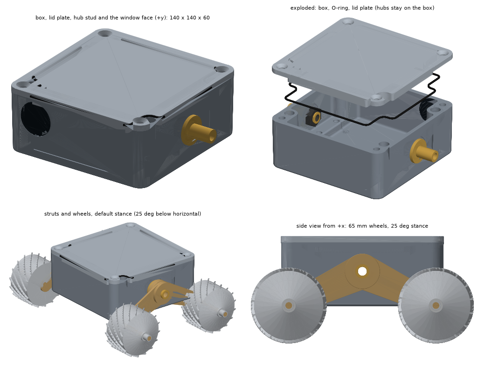

# Rover body: Hammond 1590Z090 box with a flat O-ring lid plate

Spec and design record for `hardware/body/body.py`. The target is the MUSES-CN body, **140 x 140 x 60 mm** (Jones & Wilcox: "a rectangular body, which
is 14x14x6 cm"; the mass is 1300 g in the papers' characteristics table). The script builds it from Hammond's 1590Z090 die-cast aluminium box:

1. Import the box from Hammond's STEP file (**not in this repository**; see `NOTICE.md`; the script looks for it in the private companion repository
   `../jpl-nanorover-private/cad/vendor/hammond-1590Z090/1590Z090.stp`, or at `HAMMOND_1590Z090_STP`).
2. Mill off the 1 mm feet and cut the rim down to 55 mm (this removes the 2 mm tongue above the 60 mm shoulder).
3. Replace Hammond's 30 mm cast lid with a 5 mm flat plate that carries an O-ring groove and an edge rib: 55 + 5 = 60.
4. Add cover-screw inserts, the two strut-hub studs, and (in other scripts) struts and wheels.

The preview is a rough software render (`hardware/assembly/preview.py`): nine tapered faces of Hammond's casting do not mesh, so the body shows small holes.
The STEP files are fine.

Why a casting at all: sealing. Die-cast gives walls, corner bosses and a flat rim that already work as a sealed box; the custom work is the lid.

## What the numbers say (from the script's checks, `SEAL_PATH = "original"`)

| | |
|---|---|
| Overall | 140.00 x 140.00 x 60.00 mm |
| Cavity depth | about 51 mm (floor about 4 mm), walls about 4.5 mm |
| Mass (estimates, density 2.70 g/cm3) | box about 674 g, lid plate with rib about 290 g (the rib is about 31 g), two stainless hub studs about 52 g |
| O-ring | 1.5 mm cord, 506 mm centreline; groove 2.0 wide x 1.1 deep in the plate (27% squeeze) |
| Groove position | along Hammond's own gasket path, 1.55 mm from the cavity edge; 0.55 mm of wall to the cavity, 0.60 mm to the nearest tube or bore; 100% of its area on solid rim |

## The seal path

Each corner of the casting has an M6 cover-screw bore (open at its bottom into the cavity) and a separate 11.5 mm wall-mounting
tube that runs through the floor, only 2.7 mm from the cavity wall. Two ways to route the O-ring:

- **`original` (default): follow Hammond's gasket path** through the 2.7 mm wall between the cavity and the tubes. The tubes and
  the cover-screw holes are outside the seal. The wall only takes a small cord, so this uses 1.5 mm cord in a 2.0 x 1.1 mm groove in
  the plate. Hammond's own gasket here is about 3.3 mm wide and 3 mm tall and sits in a groove about 4 mm deep in the 30 mm lid,
  which a 5 mm plate cannot hold, hence the small cord. Cord of this size is a splice-your-own item (O-ring cord stock, glued joint).
- **`outer`: a standard 1.78 mm cord near the outer face**, enclosing everything. Do not use this unless the four wall-mounting tubes
  are plugged (epoxy-filled or bonded plugs). They are open at the floor, so water can run up to the plate and across the unsealed
  plate/rim contact into the cavity.

In both layouts the four cover screws need a seal under the head (bonded sealing washers or an O-ring). In Hammond's design too, the
screw bores are open to the cavity, and the screws are sealed with O-rings under the head.

## Design notes and open problems

- **Thin margins.** About 0.55 mm of wall remains between the groove and the cavity or the tubes. That is fine for the groove cut in
  the aluminum plate, but the land that the cord presses on is only about 2.7 mm wide and has to stay flat.
- **Clamping stiffness (edge rib, modelled).** Four corner screws are 120 mm apart, so a plain 5 mm plate bows between them and loosens the
  cord. The plate carries a 3 x 8 mm rib loop on its underside, 1 mm inside the cavity wall and following the cavity outline around the
  corner bosses (481 mm long, 0.81 mm closest approach to the casting, no interference). That makes each plate edge a T-beam. Hand estimate
  for an edge strip (20 mm flange, simply supported over 120 mm, **assumed** 2 N/mm cord load, 69 GPa): second moment 208 -> 1154 mm4,
  bow about 0.38 -> 0.07 mm, against 0.4 mm of cord squeeze. The 2 N/mm load is a guess, not data, and there is no FEA behind this: check with a
  quick finite-element run or a test piece. The rib is parametric (`RIB_T`, `RIB_H`, `RIB_CLEAR`; `RIB_H = 0` removes it). It costs 8 mm of
  headroom around the inside edge only.
- **Cover-screw threads (inserts, modelled).** Each boss is only 5 mm tall (z 50 to the rim at 55), 0.83 d as a plain M6 tap, and its bore is
  open at the bottom into the cavity. The model fits a **1D (6 mm) M6 x 1.0 helical coil insert, stainless**, in each boss: drill
  6.2 mm, tap with the M6 x 1.0 insert (STI) tap, install 0.4 mm below the rim face. The tapped major diameter is about 7.2 mm and the model
  cuts the bore to that. Results from the script:
  - 4.4 mm of wall is left around each tapped hole (nearest void: the corner tube), and the insert does not overlap the casting.
  - The insert stands 1.4 mm out of the bottom of the boss (z 48.6 to 54.6). That is harmless, but the unsupported 1 mm adds no strength.
  - Screw: **M6 x 12 flat-head (ISO 10642), stainless**. 6.6 mm of thread in the 6 mm insert; tip at z = 48.0.
  - Strength, by hand: the casting's thread strip-out over 5 mm goes from about 7.3 kN as a plain M6 tap to about 10.6 kN with the insert's
    larger outer thread. **Assumed** shear strength 170 MPa for the die-cast alloy and a 0.55 thread factor, not measured. M6 preload at 2 N.m
    is about 1.7 kN, and the cord and plate need only about 0.25 kN per screw, so the plain thread was already strong enough for one assembly.
    The insert's real gain is that stainless threads survive repeated opening, where bare cast aluminum threads wear and strip.
  - Drill sizes quoted by suppliers range from 6.2 to 6.4 mm, so follow the table for the insert you buy. Check the manufacturer's note on
    thread depth for the insert length, because the bore is a through hole here.
  - Nothing else threaded into the casting is needed: the lid's plain through-holes and the O-ring under each screw head are unchanged.
- **Strut hubs (modelled, with an assumption).** Jones & Wilcox say each strut carries two motors, one for the wheel and one that turns the strut
  about its hub, and that the "shoulder hub" holds the position potentiometers. The photos show wires leaving the centre of the hub, and
  the NPO-20057 schematic shows the struts pivoting on a stationary hub with spring-loaded friction disks. I read that as a **stationary
  hollow pivot stud on each 140 x 60 face that the struts rotate on, with no rotating shaft through the wall**, so the body seals are
  static. The source papers do not spell the mechanism out, so treat this as the design choice, not as a copy of the original.
  - **Position:** x = +-70 faces (the plain walls, with no ribs within 25 mm of the hub), y = 0, z = 30 (centre of the 60 mm face).
  - **Spot-faces:** the walls lean about 1 degree, so a 30 mm outer spot-face (plane at |x| = 69.25, up to 0.5 mm deep) gives the O-ring a flat
    seat, and a 26 mm inner spot-face (plane at |x| = 65.20) does the same for the nut. 4.05 mm of wall is left at the hub.
  - **Hole:** 12.6 mm with two flats 10.8 mm apart (double-D). The stud's M12 x 1.0 shank has matching flats (10.5 mm apart), so the stud cannot
    turn when the struts push on it.
  - **Stud:** 26 mm flange, 3 mm thick, with a groove on its inner face for a 16 x 1.5 mm O-ring (27% squeeze); a 20 mm axle stub outside the
    flange as a placeholder for the strut bearings; an 8 mm bore through the middle. About 26 g each in stainless.
  - **Wires:** the bore is potted around the wires. 28 conductors of AWG30 (an estimate: two struts, each with wheel motor, strut motor, encoder
    and potentiometer) fill about 17% of the 8 mm bore before potting. A bulkhead connector in the bore would make the struts removable.
  - **Nut:** an M12 x 1.0 thin jam nut, 19 mm across flats and 6 mm thick (check the standard for the nut you buy), seats on the inner spot-face.
  - **Checks:** no overlap between the stud, nut or O-ring and the casting other than the O-ring squeeze (42 mm3).
  - **Rotating-shaft alternative.** If the strut motors move inside the body instead, each hub becomes a rotating shaft, which needs a radial lip
    seal in the wall (for example a 4 mm wide seal for a 8 mm shaft in a 16 mm bore, which the 4 mm wall can hold) and shaft bearings. That is a
    different design and is not modelled.
  - **Open:** potted wires crossing a rotating strut joint (a hollow axle allows limited twist, not continuous rotation), the strut torque
    reaction on the stud, the anti-rotation fit, and the strut bearings and seals. The struts and wheels are not modelled.
- **Viewing window (modelled).** The second JPL photo shows a round window and a small connector panel on one 140 x 60 end face. Rectified face-on (see
  `photo-measurements.md`), the window is **26 mm across, its axis 29 mm from one edge of the face and 36.8 mm above the base**, and the face measures about 140 x 62 mm.
  On the +y face, seen from outside, the window is on the left: x = +40.8, z = 36.8. The model cuts a 26 mm aperture and a 31 mm counterbore 2.4 mm deep (2.14 mm of wall left
  under the pane) and adds a 30.6 x 2.0 mm glass or acrylic pane (`window_pane.step`), bonded with RTV and recessed 0.44 mm. The wall there is plain (4.6 mm, drafted): the
  aperture's outer edge reaches the thickened corner fillet at x = 50 to 54, which adds about 90 mm3 of cutting and leaves the wall whole. Nothing behind the window is
  modelled: the camera and IR optics sit between the optical-bench panels in the papers. The photo's window looks black and glassy; its glazing, any seal beyond the adhesive, and the
  optics are open. The connector panel (about 22 x 14.5 mm, centred 59.8 mm from the same edge at the same height, with two small screws) is not modelled.
- **Not modelled yet:** the connector panel, the antenna and cell wiring feedthroughs, finish, the lid screws and O-ring washers, the wheel and strut motors.
  The plate holes are 6.6 mm with a 12.4 mm countersink for M6 flat-head screws (ISO 10642), M6 x 12.
- **Draft:** the casting is drafted (outer faces 138.4 mm wide at z = 10, 140.0 at the rim). The model keeps Hammond's geometry, so the
  60 mm height is exact and the footprint is 140 mm only at the rim.
- **Weight:** the box is heavier than a 3 mm plate box would be (about 0.6 kg), against the original rover's 1300 g.
- **Hammond's own check.** Hammond offers factory milling (modshop@hammfg.com). Their quote would tell us whether the cut and the
