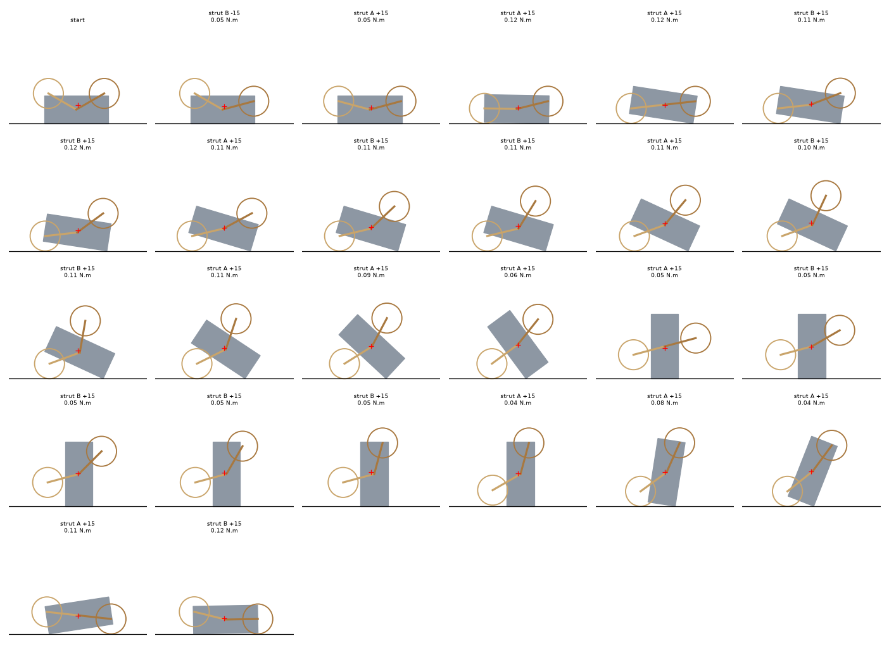

# Chassis simulation (2026-11-11)

Record for `hardware/drivetrain/chassis_sim.py` (run with `.venv/bin/python hardware/drivetrain/chassis_sim.py --figure PATH`; about 15 s). It answers the handover's step 2 for the parts that statics can answer: which stances are stable, how close they are to tipping, how much torque each strut must hold, and whether and how the rover can right itself. **It is a planar, quasi-static model; dynamics, friction, steps and slopes are not simulated.** Read the limits at the end before using a number.

## Model

- The two sides of the rover move together, so it is treated in the y-z plane (looking along the hub axis): a 140 x 60 mm body (y from -70 to 70 mm, z from 0 to 60) with the hub at its centre, and two 70 mm struts, A and B, with wheels of 32.5 mm radius at their tips. The strut angle phi is measured from +y, counter-clockwise; the default stance is A at -25 degrees and B at 205 degrees (both 25 degrees below horizontal, as in `strut.py`).
- With the struts locked, body, struts and wheels are one rigid shape. It rests on the ground in an orientation that is a local minimum of its centre-of-mass height; the ground is frictionless, so contact forces are vertical. When a strut moves, the shape changes and the assembly rolls downhill in centre-of-mass height from its old orientation to the nearest minimum (overdamped, no momentum).
- Strut torque is what that strut's servo must hold: the moment about the hub of the ground reaction on its wheel plus the weight of the strut, wheel and wheel support, per strut (half the planar value, since two sides share the load). Reactions come from force and moment balance on the one or two touching features.
- The struts cannot pass each other: the wheels collide when the two struts are less than about 60 degrees apart (`strut.py` found contact up to about 55 degrees), so both arcs between them must stay at least 60 degrees. The wheels sit outboard of the body, so they never meet it.
- **Masses (1.0 kg, planar totals for both sides):** a body lump of 386 g at the centre (what is left of the 1 kg budget after everything else; the redesigned body is not designed), servos 4 x 55 g at their positions in `hub.py` (servo B on the axis with its long side toward +y, servo A offset 23 mm toward -y), hub parts 74 g, struts 94 g, wheels 133 g, wheel supports 93 g. The centre of mass at the 25 degree stance is 2.9 mm toward -y of the hub axis and 21.9 mm above the body floor (the hub is at 30), because the two servos of a side sit on opposite sides of the axis.

## Results

**Validation.** At the 25 degree stance the model gives a body floor 32.1 mm above the ground, the same as the CAD (`strut.py`: 32.1 mm).

### Stances

Symmetric stances, upright, resting on both wheels (hold torque per strut, no margin):

| alpha (degrees below horizontal) | Body floor | COM height | Hold torque, strut A / B | Tip-over slope, forward / backward |
|---|---|---|---|---|
| 0 | 2.5 mm | 32.5 mm | 0.118 / 0.132 N.m | 66 / 64 degrees |
| 10 | 14.7 | 41.3 | 0.116 / 0.130 | 60 / 58 |
| **25** | **32.1** | **54.0** | **0.106 / 0.120** | **51 / 48** |
| 40 | 47.5 | 65.2 | 0.089 / 0.103 | 41 / 38 |
| 55 | 59.8 | 74.2 | 0.064 / 0.079 | 30 / 27 |
| 70 | 68.3 | 80.3 | 0.036 / 0.050 | 19 / 15 |
| 85 | 72.2 | 83.2 | 0.004 / 0.018 | 6 / 2 |

- The tip-over slope is the geometric angle at which the centre of mass passes over the downhill wheel contact, assuming enough friction or wheel braking to hold; it is not a slope-climbing limit. At the default stance it is about 50 degrees, so the 20 degree slope used in the wheel budget is far from tipping. A tall stance (70 degrees or more) tips at 15 to 19 degrees: **do not stand high on a slope**.
- **The hold torque at 25 degrees is 0.11 to 0.12 N.m, not the 0.155 N.m that `torque_budget.py` gave.** The earlier figure carried the whole 1 kg on the strut; the wheels, struts and wheel supports (about 0.32 kg) rest directly on the ground and do not load the strut joint, so only the body's share does (0.68 kg x 9.81 / 4 x 63.4 mm = 0.106 N.m). A and B differ by about 10 % because the centre of mass sits 2.9 mm off the hub axis.

### Self-righting from inverted

Starting upside down with the struts 30 degrees below horizontal relative to the body, one strut at a time in 15 degree moves, searched for the lowest peak torque (and, separately, the fewest moves):

| Objective | Moves | Peak strut torque (per strut, no margin) |
|---|---|---|
| lowest peak torque | 25 | **0.118 N.m** |
| fewest moves | 22 | 0.134 N.m |

How it rights itself: strut A (or both struts, in turn) swings toward the ground and pushes, rolling the body up in steps of about 8 degrees (a strut push at a time); at about 90 degrees the body stands on its 60 mm end, balanced between the struts, and then rolls over onto its wheels with the last few moves. Several steps are rolls (the body falls onto its next resting edge) and some moves are strut swings with no ground contact (0.045 N.m: only the strut's own weight). The torque is nowhere near the hold limit: the busiest moves are 0.11 to 0.13 N.m. At half the servo's no-load speed (270 degrees per second at 12 V, so 135) the 25 moves of 15 degrees take about **3 seconds** of strut motion.

### Holding-torque envelope

Over every allowed pair of strut angles on a 5 degree grid and every stable rest orientation (13,836 states): median 0.058 N.m, 95th percentile 0.137, 99th 0.155, **maximum 0.166 N.m per strut** (no margin), for example with strut A at 180 and strut B at 120 degrees, resting on one wheel with the centre of mass above it.

## What this changes

- **The strut torque requirement is half of what I had been designing to.** The maximum holding torque in any stable pose is **0.17 N.m per strut**, or about **0.33 N.m with the usual margin of 2**, against the 0.34 N.m (no margin) and 0.69 N.m (with margin) of the earlier "one pair pushes the whole weight" estimate. Statics explains it: a support must be under the centre of mass, so the contact lever is not the full 70 mm, and a wheel's own weight does not load the joint.
- **Margins for the Feetech STS3215 servo:** rated 0.98 N.m is 5.9 times the maximum hold, and the 2.9 N.m peak is 17.7 times. At the 0.33 N.m design value the gear tooth stress (module 1, 6 mm wide, 23-tooth discs, my estimate) falls from 30 to about **14.5 MPa** and the 5 mm inner shaft shear from 28 to **13 MPa**: printed gears become plausible, though still marginal for fatigue in PA12; metal remains the safe choice.
- **A smaller servo may be enough.** A servo with about 0.35 N.m peak and 0.17 N.m or more continuous torque would meet the static load. The 20 g Feetech STS3032 (4.5 kg.cm = 0.44 N.m peak, 1.5 kg.cm = 0.147 N.m rated, from the earlier search) is just under the 0.166 N.m maximum and so is not enough; a part in between was not looked up. Dynamic loads (a push against a step, an impact) are not covered, so do not shrink the servos on this result alone.
- **JPL's friction-pivot layout (layout 3 in `drivetrain-spec.md`) becomes feasible:** with the pivot friction at 0.35 N.m (twice the worst static load), the motor torque to move a strut against the friction, the 0.166 N.m load and an assumed 0.09 N.m of wheel scrub is 0.61 N.m, against 0.75 N.m for the gearhead: a 19 % margin, where the earlier over-estimate gave a shortfall of 5 %. It is not chosen; layout C stands.
- **Do not stand high:** keep the working stance at 25 to 40 degrees (tip-over 38 to 51 degrees).

## Limits

- Planar: side-to-side tipping is not modelled (the track is 275 mm wide, wider than the body is tall, so it is far less critical).
- Quasi-static, overdamped, frictionless: the "rolls" are instantaneous falls onto the next rest orientation with no momentum, impact or bounce; a real righting would use momentum and friction, which can make it easier or harder.
- One strut moves at a time and in 15 degree steps; moving both together would give faster, possibly cheaper motions.
- The body lump is a guess at 386 g centred in the box; a redesigned body with a different mass distribution changes the centre of mass and every number.
- The planar torque assumes both sides share the load equally.
- **Not simulated:** step climbing, slopes with friction, hopping (JPL's 10 cm/s, an energy-storage question), wheel torques, and the stance on uneven ground.
